# Modelagem de Banco de Dados para a Clínica Meneghini Odontologia Integrada

**Disciplina:** Modelagem de Banco de Dados (2260065), Análise e Desenvolvimento de Sistemas, UNICID
**Professor:** Cid Rodrigues de Andrade
**Entrega 1: Modelo Conceitual (DER)**, setembro de 2026; revisado em novembro de 2026 a partir da devolutiva do professor e de uma segunda rodada de levantamento na clínica
**Entrega 2: Modelo Lógico, Implementação SQL e Apresentação Final**, novembro de 2026
**Levantamento de campo (texto do grupo e fotos):** [levantamento/levantamento.md](levantamento/levantamento.md)
**Dicionário de dados completo (HTML):** [abrir no navegador](https://rsant271.github.io/modelagem-bd-meneghini-odontologia/dicionario/dicionario-de-dados.html)

## Metadados

| Nome | RGM | Usuário no GitHub |
|---|---|---|
| Renan Silva dos Santos | 47203099 | Rsant271 |
| Leonardo Alves Tavares Calixta | 47323485 | leonardo-calixta |
| David Carlos da Fonseca Junior | 46638202 | davidjunior95 |
| Vinicius Scherer Di Giorno | 47028238 | vinischerer08-hub |
| Lucas Henrique Roque Cruz | 47178922 | Lusca2803 |

**Onde está cada item da Entrega 2**

| Item do esqueleto da Entrega 2 | Onde está |
|---|---|
| 1.1 Revisão do modelo conceitual | Seção 1.1 |
| 1.2 Conversão do conceitual para o lógico | Seção 10 |
| 1.3 Definição das chaves primárias e estrangeiras | Seção 10 (tabela de conversão) e Seção 13 |
| 1.4 Normalização (1FN, 2FN e 3FN) | Seção 11 |
| 1.5 Justificativas das chaves e das restrições | Seção 13 |
| 1.6 BI e IA (indicadores e rastreabilidade) | Seção 14 |
| 2 Modelo lógico (diagrama) | Seção 12 e pasta `der/` |
| 3 e 4 Script SQL e massa de dados | Seção 15 e pasta `docs/` (dois arquivos `.sql`: banco e consultas; massa de dados) |
| 5 Levantamento, fotos e dicionário de dados | Pasta `levantamento/` e dicionário em HTML (Seção 5 e link acima) |
| 6 Uso de IA | Seção 9 |
| 7 Apresentação (slides) | ainda não feito (pasta `apresentacao/`) |

---

## Introdução

A Meneghini Odontologia Integrada é uma clínica odontológica particular no bairro Jardim São Paulo, em São Paulo (SP). Na mesma unidade trabalham dentistas de várias especialidades, um laboratório próprio de próteses e as equipes de recepção, comercial, financeiro e relacionamento. A clínica usa um software de gestão (Controle Odonto), mas ele tem integração limitada com outras ferramentas, e por isso parte das informações fica espalhada entre o sistema, planilhas e a comunicação entre os setores.

**Problema:** a clínica precisa acompanhar o caminho completo do paciente (primeiro contato, avaliação, orçamento, contrato, consultas, pedidos ao laboratório e pagamentos), e hoje essas informações não estão organizadas em um único modelo de dados.

**Objetivo:** levantar os requisitos e as regras de funcionamento da clínica por meio de pesquisa de campo e construir o modelo conceitual (DER) de um sistema de gestão de informações que organize esses dados sem redundância e sem inconsistência.

**Delimitação:** o modelo cobre o núcleo clínico, comercial e financeiro da clínica: cadastro de pacientes e colaboradores, agendamento, avaliação, orçamento, contrato e parcelas, execução dos procedimentos, evolução clínica, pedidos ao laboratório, cobrança e o caminho do paciente depois do tratamento (consulta de alta e retorno). Ficam fora desta etapa a folha de pagamento (holerite, pagamento de colaborador e ponto), as campanhas de marketing e a contabilidade. As compras de materiais, o cadastro de fornecedores e o controle de estoque também ficam fora, por um motivo diferente: o grupo não teve acesso a essa área da clínica na pesquisa de campo. Resinas, implantes e outros materiais variam por especialidade, e sem saber quem compra, como repõe e como controla, qualquer modelo seria inventado; preferimos registrar a limitação. Os leads (pessoas que ainda não compareceram à clínica) também ficam fora: eles são controlados em uma planilha do time de agendamento, a maioria não vira paciente e só esse time tem acesso. A pessoa entra no modelo quando comparece à avaliação e a recepção abre o cadastro. A clínica atende somente particular, sem convênios, e por isso o modelo não tem entidades de convênio.

---

## 1. Caracterização da Organização

**Nome e natureza da organização:** Meneghini Odontologia Integrada, clínica odontológica privada, com fins lucrativos. Oferece avaliação, clínica geral, implantodontia, ortodontia e endodontia, e tem laboratório de prótese próprio.

**Contexto e porte:** em números, a clínica tem 1 unidade, 7 consultórios com 7 cadeiras ativas, cerca de 30 colaboradores, 4 especialidades oferecidas (implantodontia, clínica geral, ortodontia e endodontia) além da avaliação inicial, e 1 laboratório de prótese próprio. Os cerca de 30 colaboradores se dividem entre dentistas (implantodontia, clínica geral, ortodontia e endodontia), auxiliares de saúde bucal, recepção, financeiro, relacionamento, campanha, marketing, comercial, laboratório e apoio (manobrista). O atendimento é particular, sem convênio. A operação é diária, com agenda dividida por dentista, consultório e horário. A clínica tem ainda um diretor clínico, que faz a consulta de alta ao fim de cada tratamento; um setor administrativo em que uma pessoa cuida só dos colaboradores (cadastro, holerites, pagamentos e folha de ponto); uma pessoa do financeiro dedicada à cobrança dos pacientes; uma gestora que lidera os setores administrativo e financeiro e mantém os cadastros de apoio (especialidades, consultórios e tabela de preços); e uma sala própria de esterilização de materiais, onde as auxiliares de saúde bucal (ASB) processam o instrumental, além de auxiliarem os dentistas em sala.

**Problemas e necessidades identificados:**

Os problemas estão numerados para que cada um possa ser rastreado até as entidades do modelo e, na Entrega 2, até a consulta SQL que o atende.

- **P1. Informação do paciente espalhada.** A planilha de leads é do setor de agendamento; a recepção só tem contato com quem já é paciente. Existem dois CRMs: um de marketing, para leads e campanhas, e o Controle Odonto, próprio para odontologia, com o prontuário. A informação existe, mas não de maneira simples de entender, e sem esse contexto fica mais difícil e mais lento agir. *Como o modelo resolve:* o caminho completo do paciente (cadastro, agendamentos, orçamentos, contrato, parcelas, evolução clínica e pedidos ao laboratório) fica em um único modelo, ligado pelo mesmo identificador do paciente; a origem dele fica guardada em `TP_ORIGEM`.
- **P2. Pedido ao laboratório sem registro único.** O pedido e o prazo de entrega da peça são combinados na conversa entre dentista, recepção e laboratório, sem um registro com status. *Como o modelo resolve:* a entidade PEDIDO_LABORATORIO guarda a data do pedido, a peça, o prazo combinado, a data de entrega e o status (solicitado, em produção, pronto, entregue).
- **P3. Orçamento aprovado em parte.** O paciente pode aprovar só parte do orçamento, e é preciso acompanhar item a item o que foi aprovado, o que está em aberto e o que já foi concluído. *Como o modelo resolve:* cada procedimento do orçamento é um ITEM_ORCAMENTO com status de aprovação e status de execução próprios, e o relacionamento EXECUTA registra em qual consulta cada item foi feito.
- **P4. Bloqueio por inadimplência.** Na hora de agendar, a recepção precisa saber se o paciente tem duas parcelas sem pagar, porque nesse caso ele não agenda e o tratamento fica interrompido até voltar a pagar (RN19). *Como o modelo resolve:* a entidade PARCELA guarda vencimento, data de pagamento e status de cada parcela, e o bloqueio é calculado a partir delas (RF16 e RF17), sem um campo a mais no cadastro do paciente.
- **P5. Retorno depois da alta.** Perto da data prevista do retorno, a recepção liga ou manda mensagem para o paciente marcar a manutenção ou limpeza, e precisa saber quais retornos vencem no período. *Como o modelo resolve:* o agendamento de alta guarda a data prevista do retorno (`DT_RETORNO_PREVISTO`), e os tipos alta e retorno entram em `TP_AGENDAMENTO` (RF18).

**Justificativa da escolha:** o grupo tem acesso garantido à clínica e ao proprietário para a pesquisa de campo. A clínica tem porte adequado ao trabalho: os processos de captação, avaliação, orçamento, contrato, agendamento, atendimento, laboratório e pagamento geram um modelo com várias entidades e relacionamentos, sem ficar grande demais para esta primeira etapa. Por ser uma organização real e em funcionamento, as regras de negócio foram levantadas diretamente com quem opera a clínica.

**Evidências da organização:**

| Item | Dado |
|---|---|
| Endereço | Av. Leôncio de Magalhães, 162, Jardim São Paulo, São Paulo/SP |
| Telefone | (11) 93455-9297 |
| E-mail | meneghiniodonto@gmail.com |
| Link no Google | [Meneghini Odontologia Integrada no Google Maps](https://www.google.com/maps/search/?api=1&query=Meneghini+Odontologia+Integrada+-+Dentista+Zona+Norte%2C+Av.+Leôncio+de+Magalhães%2C+162+-+Jardim+São+Paulo%2C+São+Paulo+-+SP) |
| Responsável pela organização | Fábio Meneghini, proprietário. Telefone: (11) 93455-9297 |
| Vínculo do grupo com a clínica | Renan Silva dos Santos trabalha na clínica, na equipe de marketing. Mesmo assim o levantamento foi feito por entrevista com o proprietário, como o trabalho pede |
| Entrevista | Feita por Renan Silva dos Santos, em nome do grupo, com Fábio Meneghini, proprietário, e Helen Meneghini, gestora, na própria clínica, em 15/09/2026. Segunda rodada de perguntas em 09/11/2026, depois da devolutiva do professor |
| Registro do contato | Foto de Renan Silva dos Santos com Helen Meneghini, gestora da clínica, na recepção (abaixo) |
| Levantamento completo | [levantamento/levantamento.md](levantamento/levantamento.md), texto escrito pelo grupo a partir da entrevista e da observação no local; as fotos ficam na mesma pasta |

Resumo do levantamento: a entrevista cobriu a identificação e o porte da clínica, o caminho do paciente (captação, avaliação sem custo, negociação, agendamento, execução, laboratório e pagamento) e as regras de cada etapa: orçamento com aprovação item a item, agenda por dentista e consultório, pedido de laboratório por paciente, pagamento por contrato com parcelas mensais e entrada de 20% no boleto. A segunda rodada completou a cobrança e a inadimplência, a consulta de alta e o retorno, o cadastro de colaboradores, a guarda do prontuário e a esterilização. O que não foi levantado (compras, fornecedores e estoque) está registrado como fora do trabalho, com o motivo.

Fotos do local:

<p align="center">
  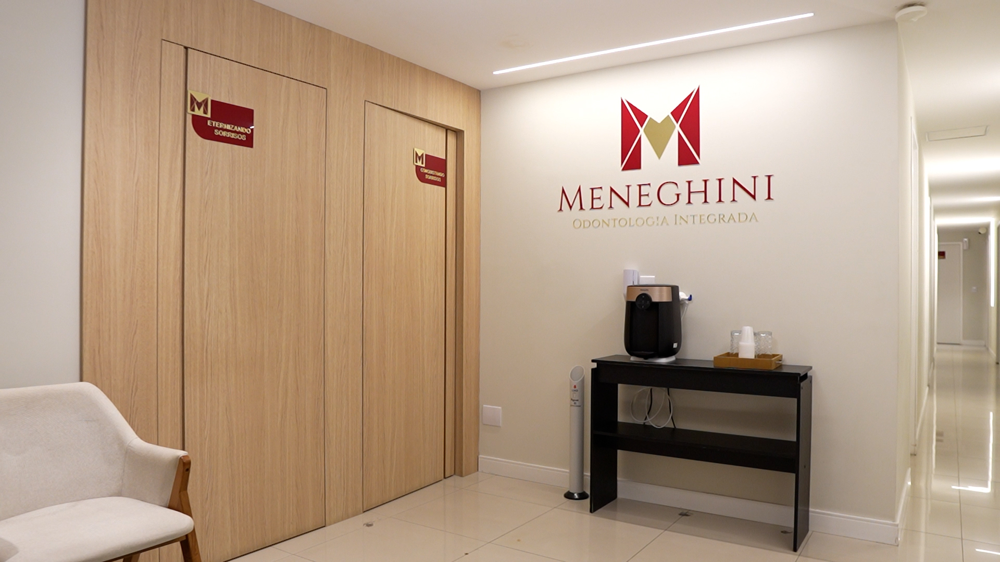
  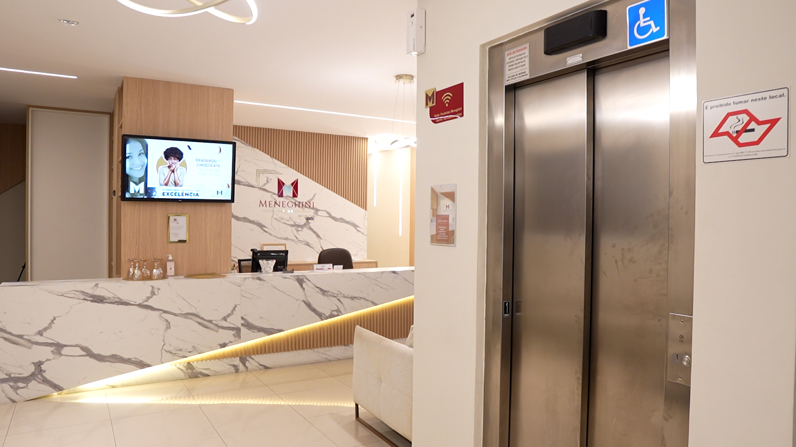
  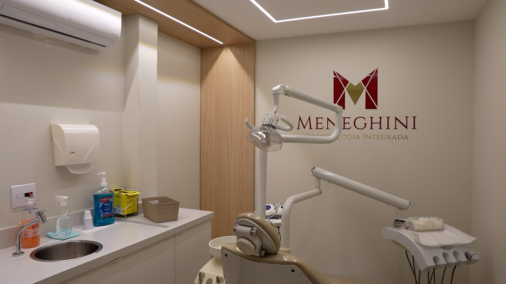
</p>
<p align="center">
  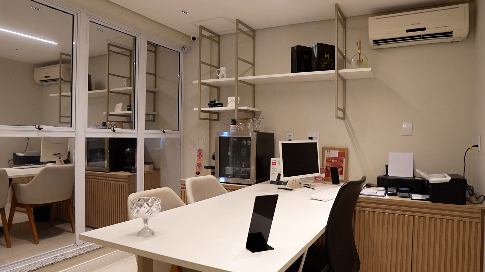
  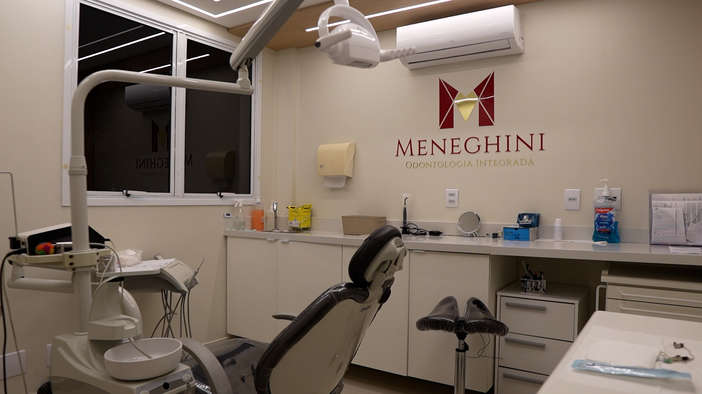
</p>

*Da esquerda para a direita, de cima para baixo: entrada com o nome da clínica, recepção, consultório, sala comercial/administrativa e um segundo consultório.*

Registro do contato:

<p align="center">
  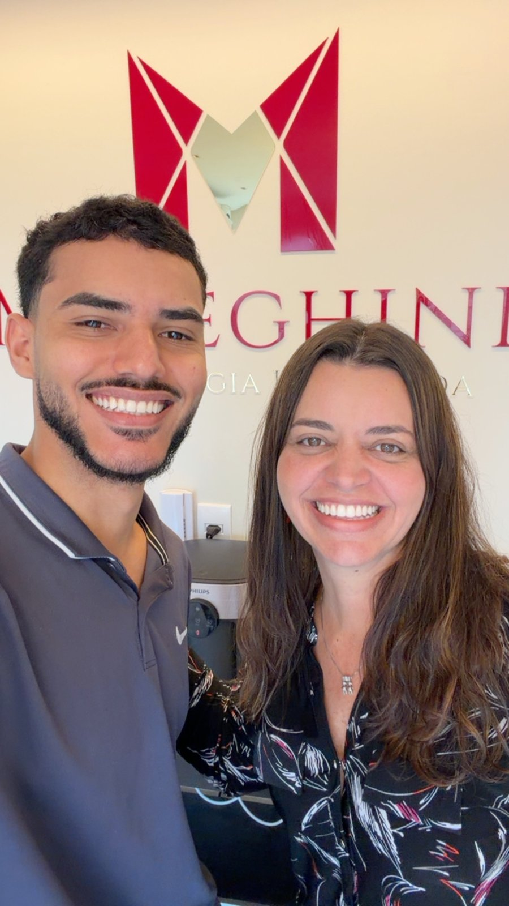
</p>

*Renan Silva dos Santos, integrante do grupo, com Helen Meneghini, gestora da clínica, na recepção da Meneghini Odontologia Integrada (novembro de 2026).*

### 1.1 Revisão da Entrega 1

A devolutiva do professor (issues #3 e #4 do repositório) apontou os itens abaixo. A tabela diz o que mudou em cada um e por quê.

| Apontamento da E1 | O que mudou | Por quê |
|---|---|---|
| Contato com a organização sem foto ou print (critério 3.2, fator 0,85) | Foto de Renan Silva dos Santos com Helen Meneghini, gestora da clínica, na recepção, publicada em `levantamento/06-visita-gestora.jpg` e citada na tabela de evidências | A visita e a entrevista estavam só relatadas em texto; a foto comprova o contato presencial |
| Processos com cobertura parcial (65%): faltavam relacionamento pós-tratamento, compra de materiais, fornecedores e estoque; cadastro de colaboradores incompleto | PR06 (alta e retorno), com fluxograma próprio; PR07 (cadastros de apoio: colaboradores, especialidades, consultórios e tabela de preços); compras, fornecedores e estoque declarados fora do levantamento na Delimitação, na Seção 2 e na Seção 8 | Voltamos à clínica em 09/11 e ela explicou como funcionam a alta, o retorno e o cadastro. A área de compras não ficou acessível ao grupo; registramos a limitação em vez de inventar um processo |
| Regras de negócio com cobertura parcial (78%): faltavam inadimplência, guarda do prontuário, biossegurança e compras | RN18 a RN24 (cobrança e inadimplência, alta e retorno, cadastro de colaboradores e cadastros de apoio); restrições de guarda do prontuário e de biossegurança reescritas na Seção 4; compras fora, pelo motivo acima | As regras vieram da segunda rodada de perguntas. A guarda do prontuário segue a Lei 13.787/2018, art. 6º, conferida no texto oficial. A biossegurança ficou como fato da clínica: sala própria de esterilização e auxiliares de saúde bucal treinadas |
| Dicionário de dados não atendido: faltavam cardinalidades e associativas, fluxo de dados, SGBD e collation, leitura das expressões, tipo físico e índices, log de acesso e acesso por operação com LGPD | Dicionário v1.2 em HTML, com todos esses itens (link no topo deste README) | Era o item de maior desconto (0,20). O dicionário da E1 só tinha atributo, descrição e regra de cada entidade |
| Observação sobre o DER: nenhuma entidade associativa com atributos próprios | Os dois relacionamentos N:N (COLABORADOR com ESPECIALIDADE e AGENDAMENTO com ITEM_ORCAMENTO) continuam sem atributos no DER; na conversão para o lógico viram as tabelas COLABORADOR_ESPECIALIDADE e AGENDAMENTO_ITEM | Nenhum dos dois tem dado próprio: a especialidade é só a ligação, e o item executado em uma consulta não tem valor nem quantidade, porque o valor fica no item do orçamento |
| Observação: a seção de IA dizia que a ferramenta "gerou as imagens do DER e dos fluxogramas" | O software usado está informado na Seção 7: as imagens são geradas por um script em Python escrito pelo grupo com apoio da ferramenta de IA e revisado pelo grupo. O uso continua declarado na Seção 9 | Os slides da Entrega 2 pedem o software usado no DER e o registro de todo uso de IA |
| Observação: último commit da E1 feito depois do envio do formulário | O conteúdo desta entrega entra na branch `main` antes do envio do formulário | Regra do repositório: só a `main` é corrigida |

---

## 2. Processos de Negócio

**Principais processos mapeados** (numerados PR01 a PR07, como os requisitos RF e as regras RN):

- **PR01 Captação e cadastro do paciente.** O lead chega por anúncio (principal canal), indicação, fachada ou parceria e fica registrado na planilha do time de agendamento, que marca a avaliação inicial (sem custo). Quando o lead comparece à clínica, a recepção abre o cadastro no sistema e ele passa a ser paciente. A avaliação acontece em um consultório disponível, com o dentista avaliador.
- **PR02 Avaliação, orçamento e contrato.** O dentista avaliador examina o paciente e monta o orçamento com procedimentos avulsos (por dente e por fase). O setor comercial negocia. Os itens aprovados viram contrato com a forma de pagamento, e o financeiro gera as parcelas.
- **PR03 Agendamento e atendimento.** A recepção agenda as consultas (paciente, dentista, consultório, data e hora), confirma a presença e registra falta ou atendimento. O dentista executa os itens do plano e registra a evolução clínica.
- **PR04 Pedido ao laboratório.** Quando o tratamento precisa de uma peça (coroa, prótese etc.), o dentista faz o pedido ao laboratório da própria clínica, que produz a peça e avisa quando está pronta.
- **PR05 Pagamento e cobrança.** As parcelas são mensais, uma por mês, registradas e baixadas no sistema. Uma pessoa do financeiro cuida da parte dos pacientes, incluindo a cobrança de quem atrasa. O tratamento avança conforme o plano e a evolução do pagamento; se o paciente para de pagar e chega a duas parcelas sem pagar, ele não consegue agendar e o tratamento é interrompido. Quando volta a pagar, o tratamento segue de onde parou no planejamento.
- **PR06 Alta e retorno.** Quando o último item do plano é concluído, a recepção agenda a consulta de alta com o diretor clínico, que confere o tratamento. Na alta fica definido o retorno do paciente, em geral seis meses depois, para manutenção ou limpeza. Essa manutenção ou limpeza costuma já estar lançada no orçamento inicial do paciente, que no Controle Odonto é um planejamento geral com tudo o que ele precisa; por isso a recepção procura deixar esse valor pago antes do retorno e, perto da data, liga ou manda mensagem para o paciente marcar. Tudo fica registrado no sistema. Hoje a clínica não faz pesquisa de satisfação nem reativação de pacientes antigos, então esses dois contatos não entram no modelo.
- **PR07 Cadastros de apoio.** O setor administrativo tem uma pessoa responsável só pelos colaboradores, dentistas ou de qualquer outra função. Ela faz o cadastro no Controle Odonto quando alguém entra e cuida de holerites, pagamentos e folha de ponto. Especialidades, consultórios e tabela de preços são mantidos pela gestora, que lidera os setores administrativo e financeiro. No modelo entram o cadastro do colaborador (nome, CPF, cargo, setor, CRO e especialidades dos dentistas, admissão e situação), as especialidades, os consultórios e os procedimentos da tabela de preços; holerite, pagamento e ponto são folha de pagamento e ficam fora.

**Fora do levantamento:** compra de materiais, cadastro de fornecedores e controle de estoque não aparecem aqui porque o grupo não teve acesso a essa área da clínica. O grupo registrou a limitação em vez de descrever um processo que não viu funcionar.

**Fluxogramas:**

PR01 e PR02: do primeiro contato ao contrato (captação, avaliação, orçamento, contrato e parcelas).

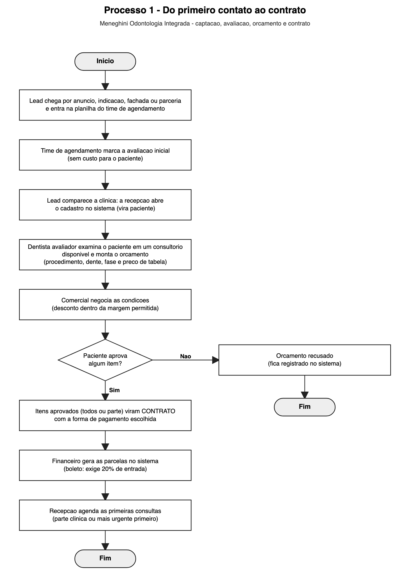

PR03: agendamento e atendimento (ciclo de cada consulta, com os status do agendamento).

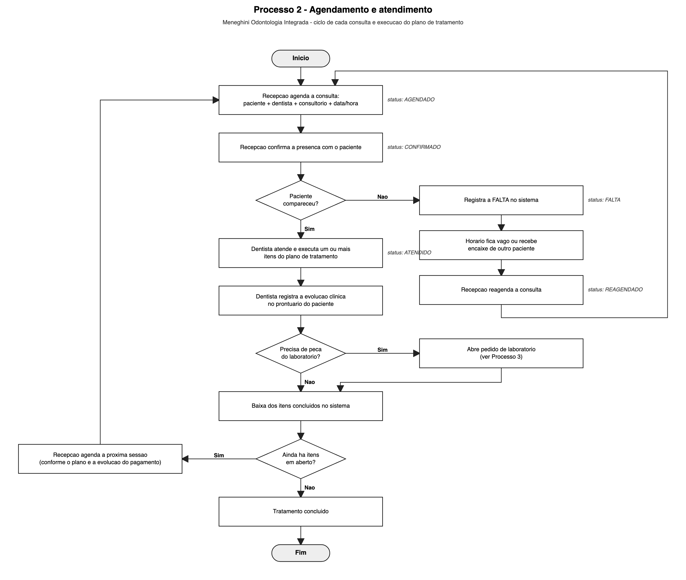

PR04: pedido ao laboratório da clínica.

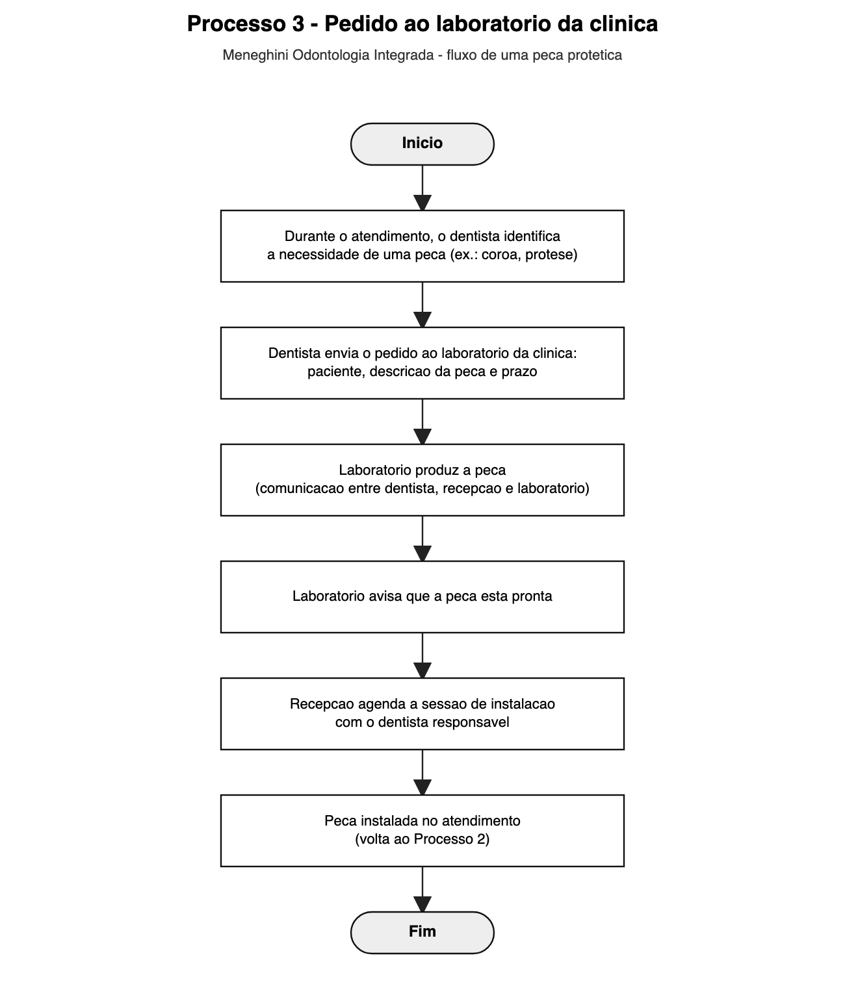

PR06: alta e retorno (fim do tratamento, consulta de alta com o diretor clínico e retorno para manutenção ou limpeza).

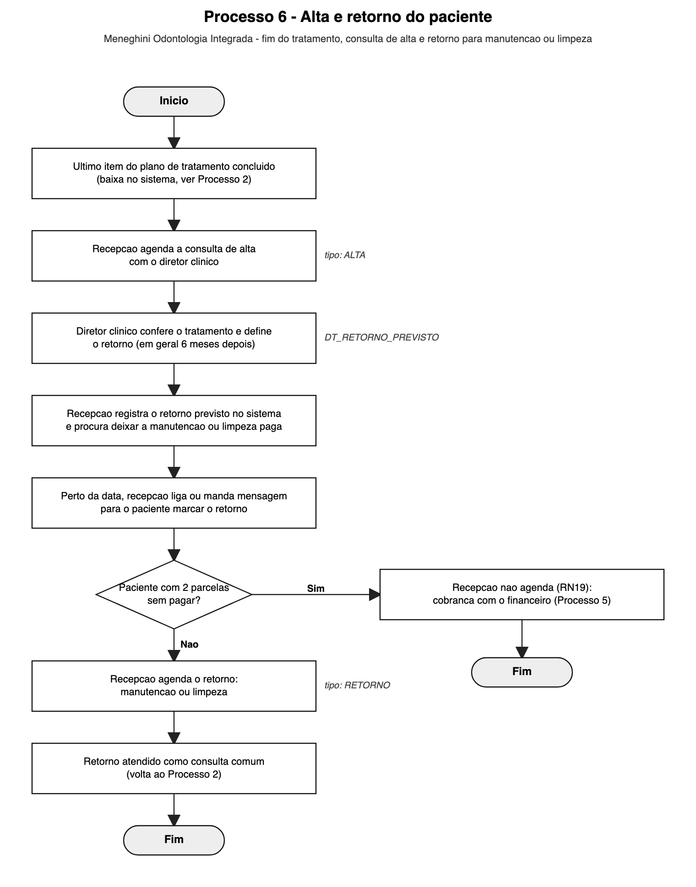

Os processos se ligam assim: o PR01 e o PR02 terminam com o contrato assinado e as primeiras consultas agendadas, que são o início do PR03. Dentro do PR03, sempre que o dentista precisa de uma peça, abre-se um pedido no PR04, e a peça pronta é instalada em uma consulta do PR03. As parcelas geradas no PR02 são baixadas pelo financeiro ao longo do tratamento (PR05), e a agenda das próximas sessões segue o plano e o andamento do pagamento. Se o paciente acumula duas parcelas sem pagar, o financeiro começa a cobrança (PR05), a recepção não agenda novas consultas e o tratamento fica interrompido. Quando o último item do plano é concluído, o PR03 leva ao PR06: consulta de alta com o diretor clínico e retorno marcado para alguns meses depois, o que traz o paciente de volta à agenda. O PR07 é de apoio: é dele que vem o cadastro de dentistas e demais colaboradores usado em todos os outros.

---

## 3. Requisitos do Sistema

### 3.1 Requisitos Funcionais

| Código | O sistema deve... |
|---|---|
| RF01 | Cadastrar pacientes com dados pessoais, contato (um ou mais telefones), endereço e canal de origem (anúncio, indicação, fachada ou parceria). |
| RF02 | Cadastrar colaboradores com cargo e setor e, para os dentistas, o número do CRO e as especialidades (uma ou mais). |
| RF03 | Cadastrar os consultórios da clínica. |
| RF04 | Manter a tabela de procedimentos com código, nome e preço de tabela. |
| RF05 | Agendar avaliações e consultas informando paciente, dentista, consultório, data e hora. |
| RF06 | Registrar a mudança de status do agendamento: agendado, confirmado, atendido, falta e reagendado. |
| RF07 | Avisar quando houver conflito de agenda (mesmo consultório ou mesmo dentista no mesmo horário). |
| RF08 | Montar orçamentos com itens por procedimento, informando dente e fase (cirúrgica, protética ou ambas). |
| RF09 | Registrar o valor negociado de cada item (com desconto) e a aprovação ou recusa item a item. |
| RF10 | Gerar o contrato a partir dos itens aprovados, com a forma de pagamento escolhida. |
| RF11 | Gerar as parcelas do contrato e permitir dar baixa em cada parcela paga. |
| RF12 | Registrar a evolução clínica de cada consulta atendida. |
| RF13 | Registrar pedidos ao laboratório, com paciente, dentista solicitante, peça, prazo e status. |
| RF14 | Acompanhar os itens do plano de tratamento em aberto e concluídos. |
| RF15 | Consultar o histórico do paciente: agendamentos, orçamentos, contratos, parcelas, evoluções e pedidos. |
| RF16 | Listar as parcelas atrasadas e os pacientes com duas parcelas sem pagar, para a cobrança do financeiro. |
| RF17 | Impedir novo agendamento para o paciente com duas parcelas sem pagar, informando o motivo à recepção. |
| RF18 | Registrar a consulta de alta com o diretor clínico e a data prevista do retorno, e listar os retornos que vencem no período para a recepção entrar em contato. |

### 3.2 Requisitos Não Funcionais

| Código | Requisito |
|---|---|
| RNF01 | Segurança e privacidade (LGPD): o acesso deve ser por perfil de usuário. A evolução clínica (dado de saúde, sensível) só pode ser vista pelos dentistas, e os dados de pagamento só pelo financeiro. |
| RNF02 | Disponibilidade: a agenda é usada o dia inteiro pela recepção, então o sistema precisa estar disponível durante todo o horário de funcionamento. |
| RNF03 | Usabilidade: a recepção precisa marcar, confirmar e reagendar consultas de forma rápida e simples. |
| RNF04 | Desempenho: a consulta da agenda do dia e a busca de paciente por nome devem responder em poucos segundos. |
| RNF05 | Rastreabilidade: o sistema deve registrar quem fez cada alteração importante (baixa de parcela, mudança de status, conclusão de item). |
| RNF06 | Integração: o modelo deve permitir, no futuro, a troca de dados com outros sistemas. Hoje essa é a principal limitação do software usado. |

---

## 4. Regras de Negócio

**Regras operacionais:**

| Código | Regra |
|---|---|
| RN01 | A avaliação inicial não tem custo para o paciente. |
| RN02 | O orçamento é montado pelo dentista avaliador, com procedimentos avulsos e especificados (procedimento, dente e fase). |
| RN03 | O preço de cada procedimento é tabelado; dentista e comercial podem dar desconto, dentro da margem permitida pela clínica. |
| RN04 | O paciente pode aprovar apenas parte dos itens do orçamento. |
| RN05 | Um orçamento com itens aprovados (todos ou parte) vira um contrato; um orçamento recusado não gera contrato. |
| RN06 | O pagamento pode ser à vista, parcelado no cartão ou parcelado no boleto; no boleto é exigida entrada de 20%. |
| RN07 | O pagamento é lançado por contrato, em parcelas; o financeiro gera a cobrança mês a mês pelo sistema e dá baixa em cada parcela paga. O comercial fecha o tratamento com o paciente novo; o financeiro cuida da cobrança e da gestão de quem já está em tratamento. |
| RN08 | O tratamento é executado de acordo com o planejamento e com a evolução do pagamento. |
| RN09 | Todo agendamento tem exatamente um paciente, um dentista, um consultório e uma data/hora. |
| RN10 | Os status possíveis de um agendamento são: agendado, confirmado, atendido, falta e reagendado. |
| RN11 | A falta do paciente fica registrada; o horário fica vago ou recebe o encaixe de outro paciente. |
| RN12 | Em uma consulta o dentista pode executar um ou mais itens do plano; cada item começa "em aberto" e passa a "concluído" quando finalizado. |
| RN13 | O consultório de cada dentista é definido pela agenda e pela data, e pode mudar ao longo da semana. |
| RN14 | Um dentista pode ter mais de uma especialidade. |
| RN15 | O pedido ao laboratório é feito por paciente, solicitado por um dentista, e o prazo é combinado entre dentista, recepção e laboratório. |
| RN16 | A evolução clínica é registrada apenas em agendamentos atendidos. |
| RN17 | Antes de comparecer à clínica, a pessoa é um lead controlado em planilha pelo time de agendamento; ela só entra no sistema (vira paciente) quando comparece à avaliação e a recepção abre o cadastro. |
| RN18 | A cobrança dos pacientes, incluindo a inadimplência, é feita por uma pessoa do financeiro dedicada a isso. |
| RN19 | As parcelas são mensais. O paciente com duas parcelas sem pagar não agenda novas consultas e o tratamento fica interrompido; quando volta a pagar, o tratamento segue de onde parou no planejamento. |
| RN20 | Quando o último item do plano é concluído, o paciente passa por uma consulta de alta com o diretor clínico, que confere o tratamento. |
| RN21 | Na alta é definido o retorno do paciente, em geral seis meses depois, para manutenção ou limpeza; a recepção agenda o retorno seguindo o processo da clínica e registra tudo no sistema. |
| RN22 | A manutenção ou limpeza do retorno em geral já está lançada no orçamento inicial do paciente (o planejamento geral); a recepção procura deixar esse valor pago com antecedência e, perto da data, entra em contato por ligação ou mensagem para marcar. |
| RN23 | O cadastro de colaboradores, dentistas ou de qualquer função, é feito pelo setor administrativo, por uma pessoa responsável só por isso. |
| RN24 | Especialidades, consultórios e tabela de preços são mantidos pela gestora, que lidera os setores administrativo e financeiro. |

**Restrições organizacionais:**

- LGPD: a clínica trata dados pessoais (nome, CPF, contato) e dados sensíveis de saúde (evolução clínica). Pela Lei 13.709/2018, esses dados exigem acesso restrito e finalidade definida. No modelo, a evolução clínica ficou em uma entidade separada para que o acesso a ela possa ser controlado. Neste trabalho não usamos nenhum dado real de paciente ou colaborador; os exemplos são fictícios.
- Guarda do prontuário: na clínica o prontuário é digital e fica no Controle Odonto. Pela Lei 13.787/2018 (art. 6º), o prontuário do paciente deve ser guardado por no mínimo 20 anos após o último registro. No modelo, a evolução clínica e os registros ligados a ela não podem ser apagados; ao fim do prazo, são anonimizados.
- Biossegurança e esterilização: a clínica tem uma sala própria de esterilização de materiais. O processamento do instrumental é feito pelas auxiliares de saúde bucal (ASB), profissionais treinadas para isso, que também auxiliam os dentistas em sala. Esse controle é da rotina da equipe da sala de esterilização e fica fora do modelo de dados, que cobre o caminho do paciente.
- Registro profissional: todo dentista precisa ter registro no CRO, então o CRO é um atributo obrigatório para colaboradores do tipo dentista.
- Atendimento particular: a clínica não trabalha com convênios, então não existem entidades de convênio ou guia.
- Uma única unidade: o modelo não tem entidade de unidade/filial, mas o consultório é uma entidade própria, o que permite crescer no futuro.
- Sistema atual: a clínica já usa o Controle Odonto, e o modelo proposto precisa ser compatível com o que a equipe já registra (agenda, orçamento por item, parcelas, prontuário, cadastro de colaboradores).

---

## 5. Dicionário de Dados

O dicionário de dados completo fica em página HTML, fora deste README: [abrir o dicionário de dados no navegador](https://rsant271.github.io/modelagem-bd-meneghini-odontologia/dicionario/dicionario-de-dados.html). O arquivo é [dicionario/dicionario-de-dados.html](dicionario/dicionario-de-dados.html).

Ele traz, para cada uma das 16 entidades, os atributos com descrição e regra de negócio, SGBD e collation, tipo físico, obrigatoriedade, leitura de cada expressão, chaves e índices, cardinalidades e entidades associativas, fluxo de dados, log de acesso e matriz de acesso com LGPD. Os nomes dos atributos seguem os prefixos do exemplo apresentado em aula (`ID_`, `NM_`, `DT_`, `TP_`, `CD_`, `QT_`, `IN_`, `DS_`), mais `NR_` (número) e `VL_` (valor em reais). Todos os exemplos de valores são fictícios.

---

## 6. Modelagem Conceitual (Entidades, Atributos, Relacionamentos)

**Entidades reconhecidas:**

| Entidade | O que representa | Por que é uma entidade |
|---|---|---|
| PACIENTE | Pessoa atendida pela clínica | É o centro de todos os processos |
| COLABORADOR | Quem trabalha na clínica (dentista, recepção, comercial, laboratório etc.) | Uma única entidade para todos os cargos evita repetir os mesmos dados; o cargo diferencia quem pode atender |
| ESPECIALIDADE | Área de atuação do dentista | Um dentista pode ter mais de uma, por isso não cabe como um simples atributo |
| CONSULTORIO | Sala de atendimento | O consultório muda conforme a agenda; ele pertence ao agendamento, não ao dentista |
| PROCEDIMENTO | Serviço da tabela de preços | Existe mesmo sem nenhum paciente |
| ORCAMENTO | Proposta feita na avaliação | É o documento que o comercial negocia e o financeiro usa |
| ITEM_ORCAMENTO | Cada procedimento do orçamento | O paciente aprova item a item e cada item tem seu próprio andamento |
| CONTRATO | Itens aprovados com forma de pagamento | Na clínica, "de orçamento passa para contrato" |
| PARCELA | Cada pagamento do contrato | As parcelas são registradas e baixadas uma a uma |
| AGENDAMENTO | Consulta marcada | Liga paciente, dentista e consultório em uma data; é o evento em que os itens são executados |
| EVOLUCAO_CLINICA | Registro do prontuário por consulta | Separada do agendamento por ser dado sensível, com acesso restrito |
| PEDIDO_LABORATORIO | Peça solicitada ao laboratório | Tem ciclo próprio (pedido, produção, pronto, entregue) |

**Atributos e classificações:** cada entidade tem um atributo identificador (ex.: `ID_PACIENTE`). As entidades fracas ITEM_ORCAMENTO e PARCELA têm identificador parcial (`NR_ITEM`, `NR_PARCELA`), que só identifica o registro junto com a entidade forte. O PACIENTE tem um atributo composto (`ENDERECO`, formado por logradouro, bairro e CEP) e um atributo multivalorado (`NR_TELEFONE`, porque o paciente pode ter mais de um telefone). Os demais atributos são simples. A lista completa está no dicionário de dados.

**Relacionamentos pertinentes:**

| Entidade | Relacionamento | Entidade | Tipo | Leitura |
|---|---|---|---|---|
| PACIENTE | MARCA | AGENDAMENTO | 1:N | Um paciente tem um ou mais agendamentos (a avaliação inicial já é um); cada agendamento é de um único paciente |
| COLABORADOR | ATENDE | AGENDAMENTO | 1:N | Um dentista atende vários agendamentos; cada agendamento tem um único dentista |
| CONSULTORIO | OCUPA | AGENDAMENTO | 1:N | Um consultório recebe vários agendamentos; cada agendamento ocupa um único consultório |
| AGENDAMENTO | REGISTRA | EVOLUCAO_CLINICA | 1:1 (opcional) | Um agendamento atendido gera uma evolução clínica; um agendamento com falta não gera |
| PACIENTE | RECEBE | ORCAMENTO | 1:N | Todo paciente recebe pelo menos um orçamento (a avaliação inicial gera o orçamento) e pode receber outros depois; cada orçamento é de um único paciente |
| COLABORADOR | AVALIA | ORCAMENTO | 1:N | O dentista avaliador monta vários orçamentos; cada orçamento tem um único avaliador |
| COLABORADOR | NEGOCIA | ORCAMENTO | 1:N (opcional) | O comercial negocia vários orçamentos; um orçamento pode ainda não ter passado pelo comercial |
| ORCAMENTO | CONTEM | ITEM_ORCAMENTO | 1:N (identificador) | Um orçamento tem um ou mais itens; cada item pertence a um único orçamento |
| PROCEDIMENTO | REFERE | ITEM_ORCAMENTO | 1:N | Um procedimento da tabela aparece em vários itens; cada item se refere a um único procedimento |
| ORCAMENTO | GERA | CONTRATO | 1:1 (opcional) | Um orçamento aprovado gera um contrato; um orçamento recusado não gera |
| CONTRATO | TEM | PARCELA | 1:N (identificador) | Um contrato tem uma ou mais parcelas; cada parcela é de um único contrato |
| AGENDAMENTO | EXECUTA | ITEM_ORCAMENTO | N:N | Em uma consulta o dentista pode executar vários itens; um item mais longo pode ocupar várias consultas |
| PACIENTE | PERTENCE | PEDIDO_LABORATORIO | 1:N | Um paciente pode ter vários pedidos; cada pedido é de um único paciente |
| COLABORADOR | SOLICITA | PEDIDO_LABORATORIO | 1:N | Um dentista solicita vários pedidos; cada pedido tem um único dentista solicitante |
| COLABORADOR | POSSUI | ESPECIALIDADE | N:N | Um dentista pode ter mais de uma especialidade; uma especialidade pode ser de vários dentistas |

**Restrições e políticas organizacionais aplicadas ao modelo:**

- Só colaboradores com cargo de dentista participam de ATENDE, AVALIA, SOLICITA e POSSUI (especialidade). Os demais cargos participam apenas de NEGOCIA (comercial).
- A evolução clínica fica em entidade própria por causa da LGPD (dado sensível de saúde, com acesso restrito).
- O preço aparece em dois lugares: `VL_TABELA` no PROCEDIMENTO (preço de tabela) e `VL_NEGOCIADO` no ITEM_ORCAMENTO (preço com desconto). Assim a clínica guarda quanto foi cobrado em cada orçamento, mesmo que a tabela mude depois.
- Não existem entidades de convênio (a clínica é particular) nem de unidade (a clínica tem um único endereço).
- A consulta de alta e o retorno são agendamentos com tipos próprios (alta e retorno); a data prevista do retorno é um atributo opcional do agendamento de alta.
- O bloqueio de agendamento por inadimplência (RN19) é calculado a partir das parcelas com status atrasada, sem atributo no PACIENTE, para não guardar a mesma informação em dois lugares.

---

## 7. Diagrama Entidade-Relacionamento (DER)

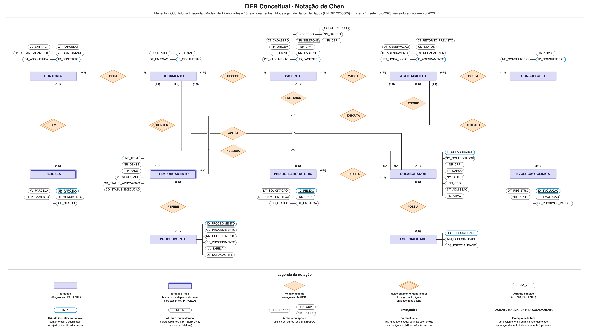

O diagrama usa a notação de Chen vista em aula: retângulo para entidade, losango para relacionamento e elipse para atributo. O atributo identificador aparece com contorno azul e sublinhado. As entidades fracas (ITEM_ORCAMENTO e PARCELA) estão com borda dupla, ligadas às entidades fortes por relacionamentos identificadores (losango duplo), e o identificador parcial delas tem o sublinhado tracejado. O atributo `NR_TELEFONE` está com borda dupla por ser multivalorado e `ENDERECO` é composto, ramificado em logradouro, bairro e CEP. A legenda na base da imagem repete esses símbolos.

Como ler as cardinalidades: seguimos a convenção do brModelo/Heuser, em que o `(mín,máx)` escrito ao lado de uma entidade indica quantas ocorrências dela se ligam a uma ocorrência da outra entidade. Por exemplo, em `PACIENTE (1,1) MARCA (1,N) AGENDAMENTO`, um paciente tem de 1 a N agendamentos, e cada agendamento é de exatamente 1 paciente.

O modelo tem 12 entidades e 15 relacionamentos, sendo 2 do tipo N:N (COLABORADOR com ESPECIALIDADE e AGENDAMENTO com ITEM_ORCAMENTO). No modelo lógico, esses dois geram tabelas intermediárias.

Software usado: o DER não foi desenhado no brModelo. Foi gerado por um script em Python escrito pelo grupo com apoio da ferramenta de IA, que produz o arquivo SVG (`der/der-meneghini-odontologia.svg`) na notação do brModelo/Heuser; o PNG foi convertido do SVG com o navegador Google Chrome. O grupo revisou o resultado entidade por entidade e cardinalidade por cardinalidade. Os fluxogramas da Seção 2 e o diagrama do modelo lógico foram feitos do mesmo jeito.

---

## 8. Justificativa Técnica

Usamos uma única entidade COLABORADOR em vez de entidades separadas para dentista, recepcionista etc. Todos os cargos têm os mesmos dados básicos (nome, CPF, setor, admissão), e criar uma entidade por cargo repetiria esses atributos. O atributo `TP_CARGO` diz quem é dentista, e `NR_CRO` só é preenchido para eles. Pensamos em usar generalização/especialização (COLABORADOR e DENTISTA), mas o único atributo exclusivo do dentista é o CRO, o que não justifica a especialização nesta etapa.

ESPECIALIDADE virou entidade, com relacionamento N:N, porque na entrevista o proprietário confirmou que um dentista pode ter mais de uma especialidade. Se especialidade fosse um atributo do colaborador, só caberia uma. Como entidade, a clínica também consegue cadastrar especialidades novas sem alterar a estrutura.

CONSULTORIO é uma entidade ligada ao AGENDAMENTO, e não ao dentista. O consultório de cada dentista é definido pela agenda e pela data e pode mudar durante a semana. Por isso ele não é um atributo do dentista: ele é definido em cada agendamento.

ITEM_ORCAMENTO é entidade fraca. O paciente pode aprovar só parte do orçamento, e cada procedimento tem seu próprio andamento (em aberto ou concluído). Isso só funciona se cada item for um registro separado, com aprovação e status próprios. O item não faz sentido fora do orçamento, por isso é identificado pelo número do item dentro do próprio orçamento.

Guardamos dois atributos de preço: `VL_TABELA` no PROCEDIMENTO e `VL_NEGOCIADO` no ITEM_ORCAMENTO. Se guardássemos só o preço de tabela, perderíamos o desconto dado. Se guardássemos só o negociado, perderíamos a referência. Com os dois, o histórico de cada orçamento fica preservado.

AGENDAMENTO foi modelado como entidade, e não só como um relacionamento. A consulta liga paciente, dentista e consultório em uma data, mas ela também precisa se ligar aos itens executados (EXECUTA) e à evolução clínica (REGISTRA). É a mesma solução usada em aula no exemplo do prontuário, em que CONSULTA é a entidade que liga PACIENTE e MEDICO.

ORCAMENTO e CONTRATO ficaram separados porque foi assim que a clínica descreveu o processo ("de orçamento passa para contrato"). O orçamento pode ser recusado; o contrato só existe quando há itens aprovados e forma de pagamento definida. Por isso o relacionamento GERA é 1:1 opcional do lado do contrato.

PARCELA é entidade fraca do CONTRATO. As parcelas são registradas e baixadas uma a uma, com vencimento e status próprios, e não existem sem o contrato.

PEDIDO_LABORATORIO está ligado ao PACIENTE e ao dentista solicitante, e não a um item específico. Modelamos como a clínica faz hoje: o pedido é feito por paciente, com a descrição da peça. Ligar o pedido a um item do orçamento seria mais preciso, mas não corresponde ao processo atual. Fica como possível melhoria.

Retiramos um relacionamento redundante. Chegamos a incluir uma ligação entre COLABORADOR e EVOLUCAO_CLINICA (quem escreveu a evolução), mas a evolução pertence a um agendamento, e o agendamento já tem o dentista. Manter os dois guardaria a mesma informação duas vezes.

As chaves estrangeiras não aparecem no DER. No modelo conceitual, a ligação entre as entidades é mostrada pelos relacionamentos. As chaves estrangeiras surgem na conversão para o modelo lógico (Entrega 2), quando a chave do lado 1 migra para o lado N.

O lead ficou fora do modelo. Ele existe só em planilha, a maioria não vira paciente (é um funil) e só o time de agendamento tem acesso. O modelo começa quando a pessoa comparece à clínica e a recepção abre o cadastro; o paciente guarda apenas de onde veio (`TP_ORIGEM`). Incluir o lead traria o marketing para dentro do modelo sem necessidade nesta etapa.

Compras de materiais, fornecedores e estoque ficaram fora porque o grupo não teve acesso a essa área da clínica na pesquisa de campo. Resinas, implantes e outros materiais variam por especialidade, e sem saber quem compra, como repõe e como controla, qualquer entidade de MATERIAL ou FORNECEDOR seria inventada. Por isso ficou registrada só a limitação.

A alta e o retorno do paciente não viraram entidades novas. Chegamos a pensar em uma entidade RETORNO, mas a alta é uma consulta com o diretor clínico e o retorno é uma consulta de manutenção ou limpeza: as duas têm paciente, dentista, consultório, data e hora, exatamente o que AGENDAMENTO já guarda. Por isso acrescentamos dois valores ao tipo do agendamento (alta e retorno) e um atributo opcional, `DT_RETORNO_PREVISTO`, preenchido na alta. A manutenção que a recepção deixa paga antes fica no orçamento inicial do paciente: na clínica esse orçamento é um planejamento geral, com tudo o que o paciente precisa já lançado, e a manutenção costuma ser um item dele (ITEM_ORCAMENTO), pago pelas parcelas do contrato.

A inadimplência ficou só nas parcelas, sem atributo novo. "Paciente bloqueado" se calcula a partir delas: se o paciente tem duas parcelas com status atrasada, a recepção não agenda (RN19). Como as parcelas são mensais, duas atrasadas são dois meses sem pagar; quando o paciente regulariza, o tratamento segue de onde parou no planejamento, e nada disso precisa ser guardado além das próprias parcelas. Guardar um indicador no PACIENTE repetiria o que as parcelas já dizem e poderia ficar desatualizado quando o financeiro desse a baixa.

Os cadastros de apoio entraram como um processo só (PR07): o cadastro de colaboradores, feito pelo setor administrativo no Controle Odonto, e as especialidades, os consultórios e a tabela de preços, mantidos pela gestora que lidera os setores administrativo e financeiro (RN24). As quatro entidades envolvidas (COLABORADOR, ESPECIALIDADE, CONSULTORIO e PROCEDIMENTO) já existiam no modelo; a segunda rodada definiu quem mantém cada uma. Holerite, pagamento de colaborador e folha de ponto são folha de pagamento e continuam fora, como já estava na delimitação.

Sobre o escopo: deixamos de fora folha de pagamento, marketing e contabilidade porque não fazem parte do caminho do paciente e tornariam o modelo grande demais para esta etapa; compras e estoque ficaram fora por falta de acesso, como explicado acima. O modelo foi montado para receber essas partes depois sem alterar o que já existe.

---

## 9. Uso de Inteligência Artificial

O trabalho foi feito pelo grupo: a escolha da clínica, a pesquisa de campo (visita, entrevista com o proprietário, Fábio Meneghini, e com a gestora, Helen Meneghini, e observação do funcionamento, feitas por Renan Silva dos Santos em nome do grupo), as decisões de escopo (sem convênio, lead e materiais fora do modelo), a lista das 12 entidades, a definição das cardinalidades em palavras a partir do funcionamento real da clínica, a correção da ordem dos processos, as regras de negócio e a revisão do texto. Nenhum dado do trabalho foi inventado por ferramenta: tudo o que está aqui veio da clínica ou de decisão do grupo.

Usamos a ferramenta Claude (Anthropic) como apoio em seis pontos, registrados abaixo no formato pedido pelo esqueleto.

| Item | Uso 1: leitura do material da disciplina |
|---|---|
| Ferramenta e etapa | Claude, no começo do trabalho, para organizar o esqueleto da entrega e os guias do professor em uma lista de exigências. |
| Motivação | Ter em um lugar só as seções, os pesos, as evidências de campo obrigatórias e a regra de LGPD. |
| Prompt(s) utilizados | "Quais são as exigências do esqueleto do professor para a Entrega 1 (organização, evidências de campo, integrantes, seções e LGPD)? Se algo não estiver no material, responda 'não informado'." |
| Resposta recebida | Lista das seções com os pesos, as quatro evidências obrigatórias (fotos, link, endereço, contato), a regra de organização real e de pequeno porte e a regra de exemplos fictícios no dicionário. |
| Fontes consultadas e verificadas | Esqueleto e material do professor no Drive da disciplina, conferidos pelo grupo. |
| Trechos rejeitados ou corrigidos | A ferramenta trouxe exigências de trabalhos de outras faculdades (ex.: "mínimo de 5 entidades"); descartamos, porque não valem aqui. Ela também marcou como "não informado" o tamanho do grupo, mas a informação estava no material do professor (3 a 5 integrantes). |
| Justificativa da escolha final | Só o que estava no material do professor entrou no trabalho. |
| Reflexão crítica | A ferramenta organiza bem, mas precisa ser cobrada pela fonte de cada afirmação. |

| Item | Uso 2: roteiro da entrevista |
|---|---|
| Ferramenta e etapa | Claude ajudou a montar as perguntas da pesquisa de campo. As respostas foram obtidas por Renan Silva dos Santos, na visita à clínica, com o proprietário e a gestora. |
| Motivação | O grupo não sabia que perguntas fazer para levantar entidades, atributos e regras de negócio. |
| Prompt(s) utilizados | "Faça as perguntas em blocos (identificação e porte, processos, regras de orçamento, agendamento, laboratório e pagamento); eu respondo com os dados da clínica." |
| Resposta recebida | Três blocos com 24 perguntas. |
| Fontes consultadas e verificadas | Todas as respostas vieram da própria clínica. A ferramenta não tinha nenhuma informação sobre ela. |
| Trechos rejeitados ou corrigidos | A ferramenta tentou estimar a distribuição dos colaboradores por setor a partir de uma resposta parcial; usamos apenas o total confirmado (cerca de 30). Ela sugeriu "especialidade" como atributo do dentista; o grupo definiu como entidade, porque na clínica um dentista pode ter mais de uma. |
| Justificativa da escolha final | O roteiro serviu de guia; o conteúdo é da pesquisa de campo. |
| Reflexão crítica | A ferramenta tende a completar lacunas com o "padrão" de uma clínica qualquer. O que não foi confirmado na entrevista ficou fora do trabalho. |

| Item | Uso 3: apoio na redação e nas imagens |
|---|---|
| Ferramenta e etapa | A ferramenta organizou as respostas da entrevista em um primeiro rascunho do texto e gerou as imagens do DER e dos fluxogramas na notação vista em aula (brModelo/Heuser). O grupo revisou entidade por entidade, relacionamento por relacionamento e cardinalidade por cardinalidade, e fez as correções listadas abaixo. |
| Motivação | Prazo curto e pouca prática do grupo com a notação do DER. |
| Prompt(s) utilizados | "Organize as respostas da entrevista no formato do esqueleto, com cardinalidade (mín,máx), e gere o DER e os fluxogramas em linguagem simples, só com o conteúdo da disciplina." |
| Resposta recebida | Rascunho das seções, dicionário com os prefixos do exemplo do professor, DER e três fluxogramas. |
| Fontes consultadas e verificadas | Respostas da entrevista e decisões do grupo; guia MER/DER, exemplo de dicionário de dados e material sobre o brModelo do professor. |
| Trechos rejeitados ou corrigidos | Correções feitas pelo grupo sobre o rascunho: (a) o lead ficou fora do modelo, porque existe só em planilha e a maioria não vira paciente; (b) os materiais ficaram fora, porque não foram levantados em campo; (c) a ordem do PR01 foi corrigida, já que o cadastro é aberto quando o lead comparece; (d) a cardinalidade entre PACIENTE e ORCAMENTO passou de "0 ou mais" para "1 ou mais", porque a avaliação sempre gera um orçamento; (e) a evolução clínica ganhou o atributo de próximos passos; (f) o parágrafo de problemas e necessidades foi reescrito com os dois CRMs da clínica; (g) uma entidade a menos ("origem de captação" virou o atributo TP_ORIGEM); (h) um relacionamento redundante entre COLABORADOR e EVOLUCAO_CLINICA foi retirado; (i) as imagens passaram por vários ajustes de layout; (j) as partes avançadas do dicionário (índices, matriz de acesso) ficaram para a Entrega 2. |
| Justificativa da escolha final | Cada entidade e cada cardinalidade do trabalho tem origem em uma resposta da entrevista ou em uma decisão do grupo. |
| Reflexão crítica | O rascunho supunha coisas que não são da clínica (paciente sem orçamento, um CRM só, lead dentro do sistema). Foi a pesquisa de campo que corrigiu. O ponto de mais cuidado foi a cardinalidade invertida, armadilha citada no material do brModelo: por isso respondemos as cardinalidades em palavras e escrevemos a regra de leitura na legenda do DER e neste README. Os pontos que ficaram em dúvida (evolução por consulta ou histórico único, teto de desconto por cargo, parcela atrasada) serão confirmados com a clínica antes da Entrega 2. |

| Item | Uso 4: revisão após a devolutiva do professor |
|---|---|
| Ferramenta e etapa | Claude, em outubro e novembro de 2026, depois da devolutiva (issues #3 e #4). Ajudou a completar o dicionário de dados em HTML e a transformar as respostas de uma segunda rodada de levantamento na clínica em processos, requisitos e regras. |
| Motivação | A devolutiva apontou processos e regras ausentes (relacionamento pós-tratamento, cadastro de colaboradores, inadimplência, guarda do prontuário, biossegurança, compras) e um dicionário incompleto. |
| Prompt(s) utilizados | "Aqui estão as respostas da clínica sobre cobrança, alta e retorno, cadastro de colaboradores e esterilização. Transforme em processos, requisitos e regras no formato do README. Não invente nada: o que não foi respondido fica de fora ou marcado como pendente." |
| Resposta recebida | PR06 e PR07, RF16 a RF18, RN18 a RN24, restrições de guarda do prontuário e de biossegurança reescritas, e o dicionário v1.2 com cardinalidades, fluxo de dados, SGBD e collation, tipo físico, índices, log de acesso e matriz de acesso com LGPD. |
| Fontes consultadas e verificadas | Respostas da clínica na segunda rodada; devolutiva e esqueletos do professor; Lei 13.787/2018 (art. 6º) e Código Civil (art. 206, § 5º, I), conferidos pelo grupo no texto oficial antes de entrar no trabalho. |
| Trechos rejeitados ou corrigidos | (a) a ferramenta levantou a opção de uma entidade RETORNO; o grupo manteve tudo em AGENDAMENTO, com os tipos alta e retorno; (b) sugeriu um indicador "bloqueado" no PACIENTE; descartamos, porque é derivado das parcelas; (c) a primeira redação da restrição de biossegurança dizia que o tema "não foi levantado" e citava a RDC 15/2012 da ANVISA; ao conferir o texto oficial, vimos que a resolução exclui do seu escopo o processamento feito em consultórios odontológicos, e a restrição foi reescrita só com o que a pesquisa de campo mostrou: sala própria de esterilização e auxiliares de saúde bucal treinadas. |
| Justificativa da escolha final | Só entrou o que a clínica respondeu. Compras, fornecedores e estoque ficaram registrados como fora do levantamento por falta de acesso, em vez de preenchidos com um processo genérico. |
| Reflexão crítica | A ferramenta tende a fechar lacuna com texto de "a confirmar" ou com uma citação de norma que soa bem. Para resolver, voltamos à clínica com perguntas específicas, escrevemos só o que foi respondido e conferimos cada citação legal na fonte antes de publicar. |

| Item | Uso 5: conversão para o modelo lógico e normalização |
|---|---|
| Ferramenta e etapa | Claude, em 10 de novembro de 2026, na conversão do DER revisado para o modelo lógico. Aplicou as regras de conversão vistas em aula, montou a primeira versão da tabela de chaves e da lista de restrições por tabela e gerou o diagrama do modelo lógico pelo mesmo método do DER (script em Python). |
| Motivação | O grupo tinha o DER e o dicionário prontos, mas pouca prática em escrever a conversão e a normalização no formato pedido pelo esqueleto. |
| Prompt(s) utilizados | "A partir do DER e do dicionário de dados, aplique as regras de conversão para o modelo lógico (1:1, 1:N, N:N, entidade fraca, atributo composto e multivalorado), liste tabela por tabela as chaves primárias e estrangeiras e verifique 1FN, 2FN e 3FN, dizendo onde cada forma normal mudou alguma coisa. Para cada restrição, cite a regra de negócio (RNxx) que a justifica. Nada fora do material da disciplina." |
| Resposta recebida | Lista das 16 tabelas com chaves, a tabela de conversão da Seção 10, a análise de normalização da Seção 11, o diagrama do modelo lógico da Seção 12 e a lista de restrições da Seção 13. |
| Fontes consultadas e verificadas | DER e dicionário de dados do próprio trabalho; material do professor sobre modelo lógico e normalização; Heuser (2009), capítulos de projeto lógico e normalização. |
| Trechos rejeitados ou corrigidos | (a) a ferramenta levantou a opção de uma tabela DENTISTA separada de COLABORADOR (especialização); o grupo manteve uma tabela só, pela mesma razão da Entrega 1; (b) levantou uma tabela de CEP para resolver a dependência entre CEP, logradouro e bairro; descartamos, porque o endereço é digitado pela recepção e uma tabela de CEPs não teria dono na clínica; (c) a primeira versão colocava uma restrição de unicidade em consultório e horário do agendamento; tiramos, porque o horário de uma falta pode ser preenchido por encaixe (RN11) e a sobreposição depende da duração, então a regra ficou para consulta de auditoria; (d) na primeira versão do diagrama as etiquetas das duas chaves estrangeiras de ORCAMENTO ficavam em cima das linhas de outras tabelas, e o layout foi ajustado. |
| Justificativa da escolha final | Cada tabela do modelo lógico vem de uma entidade ou de um relacionamento do DER, e cada restrição tem uma regra de negócio levantada na clínica. O que o banco não consegue garantir sozinho está listado na Seção 13.4. |
| Reflexão crítica | A ferramenta aplica bem as regras mecânicas de conversão, mas tende a normalizar demais (tabela de CEP, tabela de dentista) sem perguntar se aquilo faz sentido para a clínica. O critério do grupo foi: tabela nova só se alguém na clínica mantém aquele dado. |

| Item | Uso 6: script SQL, massa de dados e indicadores |
|---|---|
| Ferramenta e etapa | Claude, em 10 de novembro de 2026, na escrita dos dois arquivos `.sql` da pasta `docs/` a partir do modelo lógico e do dicionário de dados, na geração da massa de dados fictícia, no teste do script do zero em MySQL e na primeira versão da tabela de indicadores da Seção 14. |
| Motivação | Volume de escrita (16 tabelas, 19 chaves estrangeiras, centenas de linhas de INSERT) e pouca prática do grupo com gatilhos e com consultas de agrupamento. |
| Prompt(s) utilizados | "A partir do modelo lógico (Seções 10 a 13) e do dicionário de dados, escreva o script na ordem do esqueleto: CREATE DATABASE, CREATE TABLE com as restrições nomeadas, chaves estrangeiras por ALTER TABLE, INSERT, SELECT com JOIN, UPDATE, DELETE, consultas gerenciais e consultas de auditoria, no estilo do script Westeros do professor. A massa é fictícia, sem nenhum dado real, com volume justificado pelo porte da clínica e com casos errados de propósito para as auditorias devolverem linhas. Cada consulta leva o cabeçalho G ou A com a pergunta e o problema ou a regra que atende. Rode tudo do zero e mostre o resultado de cada consulta." |
| Resposta recebida | Os dois arquivos, a lista de casos propositais da massa e o resultado de cada consulta no MySQL local. |
| Fontes consultadas e verificadas | README e dicionário de dados do próprio trabalho; material do professor (unidades de SQL, DDL e DML, apostila e guia MySQL, script Westeros); documentação do MySQL 8 sobre CHECK, gatilhos e ENUM, conferida pelo grupo. |
| Trechos rejeitados ou corrigidos | (a) a primeira massa colocava consultas de alta com dentistas comuns; a regra RN20 diz que a alta é com o diretor clínico, e o grupo corrigiu três agendamentos e deixou um errado de propósito (agendamento 35) para a auditoria A09 encontrar; (b) a primeira versão das consultas G03, G07 e G12 repetia o paciente que tem dois telefones; trocamos por uma lista de telefones na mesma linha; (c) as metas dos indicadores da Seção 14 não vieram da clínica, então ficaram marcadas como proposta do grupo, para a gestora validar, em vez de aparecer como dado da clínica; (d) dois indicadores (inadimplência e retorno pós-alta) só tinham consultas de lista, sem o número; acrescentamos G13 e G14, porque indicador sem consulta que o calcule não é indicador. |
| Justificativa da escolha final | O script segue a ordem obrigatória do esqueleto, cada consulta responde a um problema (P1 a P5), a um indicador ou a uma regra do README, e tudo rodou do zero no MySQL antes de entrar no repositório. |
| Reflexão crítica | A ferramenta escreve SQL correto e rápido, mas a massa que ela gera sai limpa demais: sem os casos errados plantados, as consultas de auditoria voltariam vazias e não demonstrariam nada, como o professor alertou. O trabalho do grupo foi decidir quais erros plantar, conferir que cada consulta devolve o caso certo e explicar cada resultado com as próprias palavras, porque na apresentação cada integrante responde sozinho. |

---

## 10. Conversão do Modelo Conceitual para o Lógico

O modelo lógico é o DER traduzido para o formato que o banco de dados entende: tabelas, colunas, tipos e chaves. Fizemos a conversão seguindo as regras vistas em aula (Heuser, 2009). A tabela abaixo resume cada regra e o ponto do nosso modelo em que ela foi aplicada.

| Regra de conversão | Onde foi aplicada no modelo |
|---|---|
| Cada entidade vira uma tabela, e o identificador vira a chave primária | As 12 entidades do DER viraram 12 tabelas, cada uma com a chave `ID_` |
| Atributo composto vira uma coluna para cada parte | `ENDERECO` de PACIENTE virou `DS_LOGRADOURO`, `NM_BAIRRO` e `NR_CEP` |
| Atributo multivalorado vira tabela própria, com a chave da entidade de origem | `NR_TELEFONE` de PACIENTE virou a tabela TELEFONE_PACIENTE |
| Relacionamento 1:N: a chave do lado 1 entra como chave estrangeira na tabela do lado N | `ID_PACIENTE` em AGENDAMENTO, ORCAMENTO e PEDIDO_LABORATORIO; `ID_COLABORADOR` em AGENDAMENTO e PEDIDO_LABORATORIO; `ID_CONSULTORIO` em AGENDAMENTO; `ID_PROCEDIMENTO` em ITEM_ORCAMENTO |
| Relacionamento 1:1 opcional: a chave estrangeira fica na tabela do lado opcional e é única | CONTRATO recebe `ID_ORCAMENTO` (único); EVOLUCAO_CLINICA recebe `ID_AGENDAMENTO` (único) |
| Relacionamento N:N vira tabela intermediária com as duas chaves | COLABORADOR_ESPECIALIDADE e AGENDAMENTO_ITEM |
| Entidade fraca: a chave primária é a chave da entidade forte mais o identificador parcial | ITEM_ORCAMENTO (`ID_ORCAMENTO`, `NR_ITEM`) e PARCELA (`ID_CONTRATO`, `NR_PARCELA`) |
| Dois relacionamentos entre as mesmas entidades viram duas chaves estrangeiras com nomes diferentes | AVALIA e NEGOCIA, entre COLABORADOR e ORCAMENTO, viraram `ID_COLABORADOR_AVALIADOR` (obrigatória) e `ID_COLABORADOR_COMERCIAL` (fica vazia enquanto o orçamento não passou pelo comercial) |
| Especialização (generalização) | Não há no modelo. Avaliamos DENTISTA como especialização de COLABORADOR, mas o único atributo exclusivo do dentista é o `NR_CRO`; uma tabela a mais para uma coluna só não compensa. A regra de que só dentista atende, avalia e pede ao laboratório fica como restrição (Seção 13.4) |

**Resultado da conversão, tabela por tabela.** Doze tabelas vêm das entidades, uma do atributo multivalorado, duas dos relacionamentos N:N e uma do requisito de rastreabilidade: 16 tabelas no total.

| Origem no DER | Tabela | Chave primária | Chaves estrangeiras |
|---|---|---|---|
| PACIENTE | PACIENTE | ID_PACIENTE | nenhuma |
| atributo NR_TELEFONE (multivalorado) | TELEFONE_PACIENTE | (ID_PACIENTE, NR_TELEFONE) | ID_PACIENTE referencia PACIENTE |
| COLABORADOR | COLABORADOR | ID_COLABORADOR | nenhuma |
| ESPECIALIDADE | ESPECIALIDADE | ID_ESPECIALIDADE | nenhuma |
| relacionamento POSSUI (N:N) | COLABORADOR_ESPECIALIDADE | (ID_COLABORADOR, ID_ESPECIALIDADE) | ID_COLABORADOR referencia COLABORADOR; ID_ESPECIALIDADE referencia ESPECIALIDADE |
| CONSULTORIO | CONSULTORIO | ID_CONSULTORIO | nenhuma |
| PROCEDIMENTO | PROCEDIMENTO | ID_PROCEDIMENTO | nenhuma |
| ORCAMENTO, com RECEBE, AVALIA e NEGOCIA | ORCAMENTO | ID_ORCAMENTO | ID_PACIENTE referencia PACIENTE; ID_COLABORADOR_AVALIADOR e ID_COLABORADOR_COMERCIAL referenciam COLABORADOR |
| ITEM_ORCAMENTO (fraca), com CONTEM e REFERE | ITEM_ORCAMENTO | (ID_ORCAMENTO, NR_ITEM) | ID_ORCAMENTO referencia ORCAMENTO; ID_PROCEDIMENTO referencia PROCEDIMENTO |
| CONTRATO, com GERA (1:1) | CONTRATO | ID_CONTRATO | ID_ORCAMENTO referencia ORCAMENTO (único) |
| PARCELA (fraca), com TEM | PARCELA | (ID_CONTRATO, NR_PARCELA) | ID_CONTRATO referencia CONTRATO |
| AGENDAMENTO, com MARCA, ATENDE e OCUPA | AGENDAMENTO | ID_AGENDAMENTO | ID_PACIENTE referencia PACIENTE; ID_COLABORADOR referencia COLABORADOR; ID_CONSULTORIO referencia CONSULTORIO |
| relacionamento EXECUTA (N:N) | AGENDAMENTO_ITEM | (ID_AGENDAMENTO, ID_ORCAMENTO, NR_ITEM) | ID_AGENDAMENTO referencia AGENDAMENTO; o par (ID_ORCAMENTO, NR_ITEM) referencia ITEM_ORCAMENTO |
| EVOLUCAO_CLINICA, com REGISTRA (1:1) | EVOLUCAO_CLINICA | ID_EVOLUCAO | ID_AGENDAMENTO referencia AGENDAMENTO (único) |
| PEDIDO_LABORATORIO, com PERTENCE e SOLICITA | PEDIDO_LABORATORIO | ID_PEDIDO | ID_PACIENTE referencia PACIENTE; ID_COLABORADOR referencia COLABORADOR |
| não vem do DER (RNF05 e seção 5 do dicionário) | LOG_ALTERACAO | ID_LOG | ID_COLABORADOR referencia COLABORADOR (pode ficar vazia) |

**Ajustes feitos na conversão.** Ao passar do conceitual para o lógico, quatro coisas mudaram em relação à Entrega 1.

| O que mudou | Por quê |
|---|---|
| `CD_STATUS_APROVACAO` de ITEM_ORCAMENTO ganhou o valor `pendente`, que passou a ser o padrão | No conceitual só havia aprovado e recusado, mas o item é lançado antes de o paciente decidir (RN04). Sem o valor pendente, a coluna ficaria vazia até a resposta do paciente |
| `TP_FASE` de ITEM_ORCAMENTO passou a opcional | Fase cirúrgica ou protética só existe em implante (RN02); limpeza, canal e os demais procedimentos não têm fase |
| `NR_TELEFONE` saiu de PACIENTE e virou a tabela TELEFONE_PACIENTE | Regra do atributo multivalorado: um paciente pode ter mais de um telefone, e uma coluna não guarda lista (1FN, Seção 11) |
| Entrou a tabela LOG_ALTERACAO | Atende o RNF05 (rastreabilidade) e o log de acesso descrito no dicionário de dados. Guarda quem alterou o quê e quando, em qualquer tabela. É preenchida pelo próprio banco, no script SQL |

Os tipos de dados seguem o padrão do MySQL: `INT` para identificadores, `VARCHAR` para textos curtos, `TEXT` para textos longos, `DECIMAL(10,2)` para valores em reais, `DATE` e `DATETIME` para datas, `ENUM` para status com valores fixos e `BOOLEAN` para indicadores. O tipo de cada coluna está no diagrama (Seção 12) e no dicionário de dados.

---

## 11. Normalização

Normalizar é conferir, tabela por tabela, se cada informação está guardada em um lugar só e no lugar certo, para evitar repetição e dado contraditório. Aplicamos as três primeiras formas normais, nesta ordem, porque cada uma depende da anterior.

**Primeira forma normal (1FN).** Cada coluna guarda um valor só, sem lista e sem grupo que se repete. Onde foi necessária: em PACIENTE. O conceitual tinha `NR_TELEFONE` multivalorado e `ENDERECO` composto. Se fosse para a tabela como estava, a coluna de telefone teria dois números separados por ponto e vírgula, e o endereço inteiro ficaria em uma coluna só. O multivalorado virou a tabela TELEFONE_PACIENTE, com uma linha por telefone, e o composto virou três colunas. As outras 15 tabelas já estavam na 1FN.

**Segunda forma normal (2FN).** Vale para tabelas com chave primária composta: toda coluna fora da chave precisa depender da chave inteira, e não de uma parte dela. Onde foi conferida: nas quatro tabelas com chave composta. Em ITEM_ORCAMENTO (`ID_ORCAMENTO`, `NR_ITEM`), as colunas `NR_DENTE`, `TP_FASE`, `VL_NEGOCIADO` e os dois status dependem do item inteiro. A data de emissão e a situação do orçamento dependem só de `ID_ORCAMENTO`, por isso ficam em ORCAMENTO e não se repetem a cada item. Em PARCELA (`ID_CONTRATO`, `NR_PARCELA`), valor, vencimento e pagamento dependem da parcela; a forma de pagamento depende só do contrato e fica em CONTRATO. COLABORADOR_ESPECIALIDADE e AGENDAMENTO_ITEM só têm as colunas da chave, então passam direto. As tabelas de chave simples estão na 2FN por definição.

**Terceira forma normal (3FN).** Nenhuma coluna fora da chave pode depender de outra coluna fora da chave (dependência transitiva). Onde foi conferida e o que decidimos:

- COLABORADOR tem `TP_CARGO` e `NM_SETOR`. Parece que o cargo determina o setor, mas na clínica não é assim: o diretor clínico é dentista e também atende, e a gestora lidera dois setores (administrativo e financeiro). Como o cargo não determina o setor sozinho, não há dependência transitiva, e as duas colunas ficam.
- PACIENTE tem `NR_CEP`, `DS_LOGRADOURO` e `NM_BAIRRO`. A rigor, o CEP determina logradouro e bairro. Resolver isso exigiria uma tabela de CEPs, que ninguém na clínica mantém: o endereço é digitado pela recepção no cadastro. Mantivemos as três colunas em PACIENTE e registramos a decisão.
- ORCAMENTO guarda `VL_TOTAL` e CONTRATO guarda `VL_CONTRATADO`, que poderiam ser calculados a partir dos itens. Não é dependência entre colunas da mesma tabela, então a 3FN não é violada, mas é uma redundância. Mantivemos os dois porque o valor fechado com o paciente precisa ficar registrado mesmo que um item mude de situação depois, e uma consulta de auditoria confere se a soma dos itens bate com o total.

Resultado: as 16 tabelas estão na 3FN. A única exceção é o CEP em PACIENTE, mantida de propósito e registrada acima. Os valores totais não violam a 3FN, mas ficaram registrados como redundância controlada.

---

## 12. Modelo Lógico

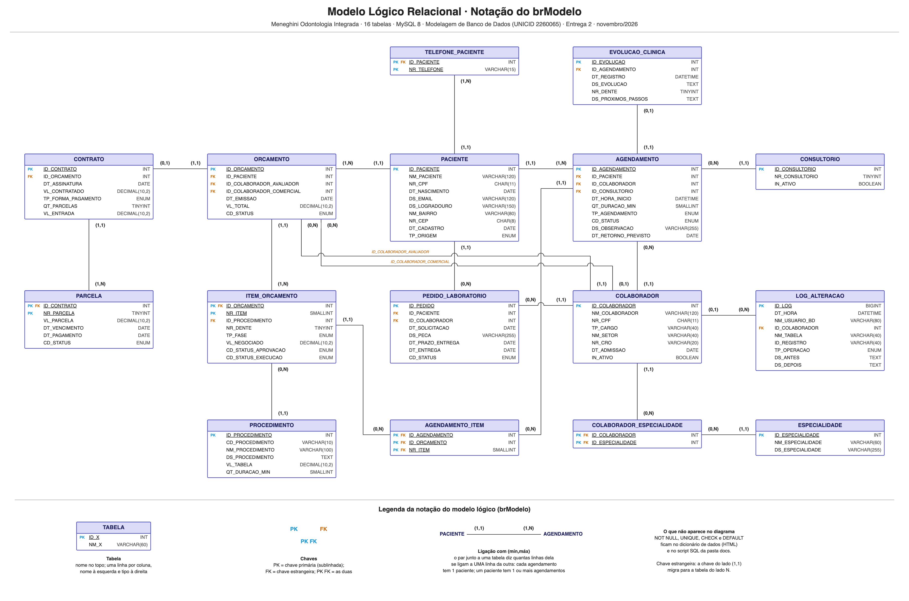

Como ler o diagrama: ele segue a notação do brModelo para o modelo lógico. Cada tabela é um retângulo com o nome no topo e uma linha por coluna, com o nome à esquerda e o tipo à direita. A chave primária está sublinhada e marcada com PK; a chave estrangeira está marcada com FK; a coluna que é as duas coisas ao mesmo tempo (chave composta de entidade fraca ou de tabela intermediária) está marcada com PK FK. Cada ligação é uma linha entre a chave estrangeira e a chave primária que ela referencia, com o `(mín,máx)` em cada ponta, na mesma leitura do DER (Seção 7). As duas chaves estrangeiras de ORCAMENTO para COLABORADOR têm o nome escrito na própria linha, para não confundir uma com a outra.

O que não aparece no diagrama: NOT NULL, UNIQUE, CHECK e DEFAULT. A notação não tem símbolo para eles. Essas restrições estão na Seção 13, na seção 7 do dicionário de dados e no script SQL.

Software usado: o mesmo método do DER (Seção 7). Um script em Python escrito pelo grupo com apoio da ferramenta de IA gera o arquivo SVG (`der/modelo-logico-meneghini-odontologia.svg`), e o PNG foi convertido com o Google Chrome.

Resumo das 16 tabelas:

| Tabela | Chave primária | Chaves estrangeiras | Colunas únicas |
|---|---|---|---|
| PACIENTE | ID_PACIENTE | nenhuma | NR_CPF |
| TELEFONE_PACIENTE | ID_PACIENTE, NR_TELEFONE | ID_PACIENTE | |
| COLABORADOR | ID_COLABORADOR | nenhuma | NR_CPF, NR_CRO |
| ESPECIALIDADE | ID_ESPECIALIDADE | nenhuma | NM_ESPECIALIDADE |
| COLABORADOR_ESPECIALIDADE | ID_COLABORADOR, ID_ESPECIALIDADE | ID_COLABORADOR, ID_ESPECIALIDADE | |
| CONSULTORIO | ID_CONSULTORIO | nenhuma | NR_CONSULTORIO |
| PROCEDIMENTO | ID_PROCEDIMENTO | nenhuma | CD_PROCEDIMENTO |
| ORCAMENTO | ID_ORCAMENTO | ID_PACIENTE, ID_COLABORADOR_AVALIADOR, ID_COLABORADOR_COMERCIAL | |
| ITEM_ORCAMENTO | ID_ORCAMENTO, NR_ITEM | ID_ORCAMENTO, ID_PROCEDIMENTO | |
| CONTRATO | ID_CONTRATO | ID_ORCAMENTO | ID_ORCAMENTO |
| PARCELA | ID_CONTRATO, NR_PARCELA | ID_CONTRATO | |
| AGENDAMENTO | ID_AGENDAMENTO | ID_PACIENTE, ID_COLABORADOR, ID_CONSULTORIO | |
| AGENDAMENTO_ITEM | ID_AGENDAMENTO, ID_ORCAMENTO, NR_ITEM | ID_AGENDAMENTO; (ID_ORCAMENTO, NR_ITEM) | |
| EVOLUCAO_CLINICA | ID_EVOLUCAO | ID_AGENDAMENTO | ID_AGENDAMENTO |
| PEDIDO_LABORATORIO | ID_PEDIDO | ID_PACIENTE, ID_COLABORADOR | |
| LOG_ALTERACAO | ID_LOG | ID_COLABORADOR | |

---

## 13. Justificativas do Modelo Lógico

### 13.1 Chaves primárias

Nas tabelas fortes usamos um identificador numérico (`ID_`), inteiro com auto-incremento. Ele é curto, nunca muda e não expõe dado pessoal. Não usamos o CPF como chave primária do paciente nem do colaborador: o CPF pode ser digitado errado e corrigido depois, e é dado pessoal protegido pela LGPD. Ele fica como coluna única (UNIQUE), o que impede cadastro em duplicidade sem usá-lo como chave.

Nas entidades fracas a chave é composta: (`ID_ORCAMENTO`, `NR_ITEM`) e (`ID_CONTRATO`, `NR_PARCELA`). O item só existe dentro do orçamento, e a chave composta impede dois itens com o mesmo número no mesmo orçamento. Nas tabelas intermediárias dos N:N a chave é o conjunto das chaves estrangeiras, o que impede registrar a mesma especialidade duas vezes para o mesmo dentista, ou o mesmo item duas vezes na mesma consulta.

### 13.2 Chaves estrangeiras

Toda chave estrangeira aponta para a chave primária da tabela de origem. Nas obrigatórias, lado `(1,1)` do diagrama, a coluna é NOT NULL. Nas opcionais, lado `(0,1)`, a coluna pode ficar vazia: `ID_COLABORADOR_COMERCIAL` em ORCAMENTO e `ID_COLABORADOR` em LOG_ALTERACAO.

Ao apagar: todas as chaves estrangeiras bloqueiam a exclusão do registro de origem (ON DELETE RESTRICT). Um paciente com agendamento, orçamento ou pedido não pode ser apagado, e um procedimento usado em algum item também não. Isso segue o que a matriz de acesso do dicionário já dizia: na clínica nenhum papel apaga registro, por causa do histórico financeiro e da guarda do prontuário (Lei 13.787/2018). A única exceção é TELEFONE_PACIENTE, que é apagada junto com o paciente (ON DELETE CASCADE), porque o telefone é parte do cadastro e não tem vida própria.

Ao atualizar: os identificadores são gerados pelo banco e não mudam, então não há regra de atualização em cascata.

### 13.3 Restrições de integridade e a regra de negócio de cada uma

| Restrição | Tabela e coluna | Regra que justifica |
|---|---|---|
| UNIQUE | PACIENTE.NR_CPF; COLABORADOR.NR_CPF | Cadastro sem duplicidade (PR01 e RN23) |
| CHECK: 11 dígitos | PACIENTE.NR_CPF; COLABORADOR.NR_CPF | CPF guardado sem máscara, só os dígitos |
| DEFAULT: data atual | PACIENTE.DT_CADASTRO | O cadastro é aberto no dia da avaliação (RN17) |
| UNIQUE | COLABORADOR.NR_CRO | O registro profissional não se repete |
| CHECK: cargo dentista ou diretor clínico exige NR_CRO | COLABORADOR | Só dentista atende, avalia e pede ao laboratório; o CRO é o que identifica o dentista |
| DEFAULT: verdadeiro | COLABORADOR.IN_ATIVO; CONSULTORIO.IN_ATIVO | Cadastro novo nasce ativo; desligamento desativa em vez de apagar |
| UNIQUE | ESPECIALIDADE.NM_ESPECIALIDADE; CONSULTORIO.NR_CONSULTORIO; PROCEDIMENTO.CD_PROCEDIMENTO | Cadastros de apoio mantidos pela gestora, sem repetição (RN24) |
| CHECK: valor maior ou igual a zero | PROCEDIMENTO.VL_TABELA | RN01: a avaliação tem preço zero, então o valor pode ser zero, mas não negativo |
| DEFAULT: em negociação; DEFAULT: 0 | ORCAMENTO.CD_STATUS; ORCAMENTO.VL_TOTAL | O orçamento nasce na avaliação e segue para o comercial (RN02, PR02) |
| CHECK: dente entre 11 e 48 | ITEM_ORCAMENTO.NR_DENTE | Numeração dos dentes permanentes; opcional porque nem todo procedimento é por dente |
| CHECK: valor maior ou igual a zero | ITEM_ORCAMENTO.VL_NEGOCIADO | RN03: preço tabelado com desconto, nunca negativo |
| DEFAULT: pendente; DEFAULT: em aberto | ITEM_ORCAMENTO.CD_STATUS_APROVACAO; ITEM_ORCAMENTO.CD_STATUS_EXECUCAO | RN04 (aprovação item a item) e RN12 (todo item nasce em aberto) |
| UNIQUE e NOT NULL | CONTRATO.ID_ORCAMENTO | RN05: um orçamento gera no máximo um contrato, e todo contrato vem de um orçamento |
| CHECK: valor maior que zero; CHECK: parcelas maior ou igual a 1, DEFAULT 1 | CONTRATO.VL_CONTRATADO; CONTRATO.QT_PARCELAS | Contrato sem valor não existe; pagamento à vista é uma parcela só |
| CHECK: à vista exige uma parcela | CONTRATO | RN06: formas de pagamento |
| CHECK: boleto exige entrada de pelo menos 20% do valor | CONTRATO.VL_ENTRADA | RN06: no boleto é exigida entrada de 20% |
| CHECK: valor maior que zero; DEFAULT: aberta | PARCELA.VL_PARCELA; PARCELA.CD_STATUS | RN07: parcelas registradas e baixadas uma a uma |
| CHECK: parcela paga exige data de pagamento | PARCELA | RN07: a baixa registra a data |
| DEFAULT: agendado; CHECK: duração maior que zero | AGENDAMENTO.CD_STATUS; AGENDAMENTO.QT_DURACAO_MIN | RN10: estados do agendamento |
| CHECK: data de retorno só em agendamento do tipo alta | AGENDAMENTO.DT_RETORNO_PREVISTO | RN21: o retorno é definido na consulta de alta |
| UNIQUE | EVOLUCAO_CLINICA.ID_AGENDAMENTO | RN16: uma evolução por consulta |
| DEFAULT: data e hora atuais | EVOLUCAO_CLINICA.DT_REGISTRO; LOG_ALTERACAO.DT_HORA | Registro no momento do atendimento e da alteração |
| DEFAULT: solicitado; DEFAULT: data atual | PEDIDO_LABORATORIO.CD_STATUS; PEDIDO_LABORATORIO.DT_SOLICITACAO | RN15: o pedido nasce solicitado no dia |
| CHECK: prazo maior ou igual à solicitação; CHECK: entregue exige data de entrega | PEDIDO_LABORATORIO | RN15: prazo combinado na solicitação; entrega registrada com data |

### 13.4 Regras que o banco não garante sozinho

Algumas regras envolvem mais de uma tabela ou um cálculo, e o CHECK do MySQL só enxerga a própria linha. Elas ficam para a aplicação ou para gatilho (trigger), e cada uma ganha uma consulta de auditoria no script SQL, que mostra se a regra foi quebrada:

- RN03: o `VL_NEGOCIADO` do item não pode passar do `VL_TABELA` do procedimento.
- RN09 e RF07: dois agendamentos não podem ocupar o mesmo consultório, nem o mesmo dentista, no mesmo horário. Uma coluna única não resolve, porque a sobreposição depende da duração e porque o horário de uma falta pode ser preenchido por encaixe (RN11).
- Só colaborador com cargo de dentista pode atender, avaliar, pedir ao laboratório e ter especialidade.
- RN16: a evolução clínica só pode ser registrada em agendamento com situação atendido.
- RN19: paciente com duas parcelas atrasadas não agenda. É calculado a partir de PARCELA, sem coluna no PACIENTE.
- O `VL_TOTAL` do orçamento deve ser igual à soma dos itens, e o `VL_CONTRATADO` à soma dos itens aprovados.

---

## 14. Arquitetura Analítica para BI e IA

Esta seção responde ao item 1.6 do esqueleto: que informações a direção da clínica precisa, quais indicadores o banco consegue calcular, de que tabelas e de que consulta cada um sai, e o que dá para fazer depois com painéis e com previsão.

### 14.1 Informações estratégicas

Na pesquisa de campo, cada setor tem uma pergunta que hoje é respondida de cabeça ou olhando a planilha e os dois CRMs separados:

- Financeiro e gestora: quanto entrou no mês e quanto está vencido sem pagar (P4).
- Comercial: quantos orçamentos viram contrato e quais estão parados em negociação (P3).
- Recepção e diretor clínico: se os consultórios estão ocupados, quantos pacientes faltam e quem precisa ser chamado para o retorno depois da alta (P5).
- Laboratório e dentistas: quais peças estão atrasadas (P2).
- Dentista em consulta: o histórico completo do paciente em um lugar só (P1).

O atributo `TP_ORIGEM` do paciente permite ainda saber de onde vêm os pacientes que fecham contrato (anúncio, indicação, fachada ou parceria). O modelo guarda tudo isso nas mesmas 16 tabelas do dia a dia, e por isso cada pergunta vira uma consulta SQL na Parte 3 de `docs/01-banco-e-consultas.sql` (G01 a G15), sem planilha paralela.

### 14.2 Indicadores (KPIs)

Um indicador só entra aqui se tem fórmula, período e meta, e se existe uma consulta no script que o calcula. As metas não vieram da clínica: a pesquisa de campo levantou processos e regras, não números de meta. Por isso cada meta abaixo é uma proposta do grupo, para a gestora validar ou trocar.

| Indicador | Fórmula | Período | Meta (proposta do grupo) | Consulta |
|---|---|---|---|---|
| Faturamento recebido | entradas dos contratos assinados no mês + parcelas pagas no mês | mensal | crescer em relação à média dos três meses anteriores | G08 |
| Taxa de inadimplência | valor das parcelas vencidas e não pagas ÷ valor de todas as parcelas vencidas × 100 | foto do dia, conferida no fechamento do mês | abaixo de 5% | G13 (detalhe por contrato em G02; pacientes bloqueados em G03) |
| Taxa de conversão de orçamentos | orçamentos aprovados, inteiros ou em parte ÷ orçamentos emitidos no mês × 100 | mensal | 70% ou mais | G05 (por origem do paciente em G11) |
| Ocupação dos consultórios | minutos de consultas atendidas ÷ (dias úteis × 8 h × 60) × 100, por consultório | mensal | 60% ou mais | G09 |
| Taxa de falta | consultas com falta ÷ (atendidas + faltas) × 100 | mensal | abaixo de 10% | G10 |
| Taxa de retorno pós-alta | retornos realizados ÷ retornos previstos já vencidos × 100 | acumulado, conferido todo mês | 80% ou mais | G14 (lista de quem chamar em G07) |

Duas observações sobre a massa fictícia. As 8 horas por dia da ocupação são uma suposição do grupo para a fórmula; a clínica troca pelo horário real de funcionamento. E na massa a ocupação fica abaixo de 2%, porque o recorte de quatro meses tem poucas consultas por consultório: o que vale é a fórmula, que na clínica usa a agenda inteira.

### 14.3 Rastreabilidade: problema ou indicador, tabelas e consulta

A tabela abaixo liga cada problema da Seção 1 e cada indicador às tabelas de onde o dado sai e à consulta que responde. As consultas G estão na Parte 3 e as A na Parte 4 de `docs/01-banco-e-consultas.sql`; o cabeçalho de cada uma repete a pergunta e o que ela atende ou verifica.

| Problema ou indicador | Tabelas usadas | Consultas |
|---|---|---|
| P1 Informação do paciente espalhada | PACIENTE, AGENDAMENTO, COLABORADOR, AGENDAMENTO_ITEM, ITEM_ORCAMENTO, PROCEDIMENTO, EVOLUCAO_CLINICA | G01 |
| P2 Pedido ao laboratório sem registro único | PEDIDO_LABORATORIO, PACIENTE, COLABORADOR, AGENDAMENTO | G06; A07 |
| P3 Orçamento aprovado em parte | ORCAMENTO, ITEM_ORCAMENTO, PROCEDIMENTO, AGENDAMENTO_ITEM, AGENDAMENTO, CONTRATO, PACIENTE | G04, G05, G12; A01, A02, A08 |
| P4 Bloqueio por inadimplência | CONTRATO, PARCELA, ORCAMENTO, PACIENTE, TELEFONE_PACIENTE, AGENDAMENTO | G02, G03, G13; A03, A06 |
| P5 Retorno depois da alta | AGENDAMENTO (tipos alta e retorno), PACIENTE, TELEFONE_PACIENTE, COLABORADOR | G07, G14; A09 |
| Faturamento recebido | CONTRATO, PARCELA | G08 |
| Taxa de inadimplência | PARCELA | G13 |
| Taxa de conversão de orçamentos | ORCAMENTO, CONTRATO, PACIENTE | G05, G11 |
| Ocupação dos consultórios | AGENDAMENTO, CONSULTORIO | G09 |
| Taxa de falta | AGENDAMENTO | G10 |
| Taxa de retorno pós-alta | AGENDAMENTO | G14 |
| Regras de agenda e de prontuário (RN09, RN10, RN16) | AGENDAMENTO, CONSULTORIO, COLABORADOR, EVOLUCAO_CLINICA | A04, A05 |
| Rastreabilidade (RNF05) | LOG_ALTERACAO, COLABORADOR | A10 |

### 14.4 Painéis (dashboards)

O banco deste trabalho é o banco do dia a dia: a recepção agenda, o financeiro dá baixa, o dentista registra a evolução. Um painel de BI não deve ler essas tabelas direto, por dois motivos: uma consulta pesada atrapalha quem está atendendo, e o painel de números não precisa de nome, CPF, telefone nem evolução clínica. A proposta do grupo tem três camadas:

1. O banco MySQL do dia a dia, com as 16 tabelas deste trabalho.
2. Uma camada de leitura: views (consultas gravadas no banco com nome, que se usam como se fossem tabela) ou uma extração diária, que entregam os números já somados por mês, por consultório e por origem, sem dado pessoal. As consultas G05, G08, G09, G10, G11, G13 e G14 já são essa camada: nenhuma delas devolve nome de paciente.
3. A ferramenta de painel (Looker Studio, Power BI ou parecida), ligada só à camada 2.

As listas com nome e telefone (G03, quem cobrar; G07, quem chamar para o retorno; G12, quem o comercial liga) não entram em painel aberto: ficam com quem já tem esse direito na matriz de acesso do dicionário de dados. Três painéis, um por público:

| Painel | Quem vê | O que mostra | Consultas de origem |
|---|---|---|---|
| Financeiro | gestora e financeiro | recebido por mês, taxa de inadimplência, contratos com parcela vencida | G08, G13, G02 |
| Agenda | diretor clínico e recepção | ocupação por consultório, faltas por mês, retornos vencidos, peças atrasadas no laboratório | G09, G10, G14, G06 |
| Comercial | comercial e marketing | conversão por mês e por origem, orçamentos parados em negociação | G05, G11, G12 |

### 14.5 Aplicações analíticas e preditivas

Com histórico acumulado (o recorte de quatro meses da massa não serve para isso; é preciso pelo menos um ano de agenda e de parcelas), as mesmas tabelas permitem três usos de previsão, todos simples de explicar para a clínica:

- Risco de falta: a partir do histórico de faltas do paciente, do dia da semana, do horário, do tipo de consulta e da origem (AGENDAMENTO e PACIENTE), ordenar a agenda do dia seguinte por chance de falta. A recepção confirma primeiro quem tem mais risco e já prepara o encaixe (RN11).
- Risco de atraso de parcela: forma de pagamento, valor e atrasos anteriores do mesmo paciente (CONTRATO e PARCELA). O financeiro manda o lembrete antes do vencimento para quem tem mais risco, em vez de cobrar todo mundo depois (RN18).
- Risco de não voltar depois da alta: tempo desde a alta, faltas durante o tratamento e retorno anterior (AGENDAMENTO). O relacionamento liga primeiro para quem tem mais chance de sumir (PR06).

Limites definidos desde já: a evolução clínica, dado sensível pela LGPD, fica fora de qualquer modelo; o modelo só ordena a lista, e a decisão continua com a pessoa (a recepção decide se liga, o financeiro decide se cobra); o treinamento usa dados sem nome e sem CPF, com o identificador trocado por um código; e o LOG_ALTERACAO continua registrando quem alterou o quê, o que permite auditar depois qualquer ação tomada a partir dessas listas (A10).

---

## 15. Script SQL e Massa de Dados

Os arquivos `.sql` ficam na pasta `docs/`, como pedem os slides da Entrega 2. São dois, como o professor pediu: um com a massa de dados e outro com todo o resto (criação do banco, manipulação e consultas), dividido em quatro partes que seguem a ordem obrigatória do esqueleto:

| Arquivo | Parte | O que faz | Itens da ordem do esqueleto |
|---|---|---|---|
| `docs/01-banco-e-consultas.sql` | 1 | DROP e CREATE DATABASE; as 16 tabelas com NOT NULL, UNIQUE, CHECK e DEFAULT nomeados; as 19 chaves estrangeiras por ALTER TABLE; os índices; os seis gatilhos que preenchem LOG_ALTERACAO | 1, 2 e 3 |
| `docs/02-massa-de-dados.sql` | | massa fictícia: 26 pacientes, 31 telefones, 17 colaboradores, 4 especialidades, 7 consultórios, 15 procedimentos, 26 orçamentos com 61 itens, 20 contratos com 76 parcelas, 75 agendamentos, 60 evoluções clínicas e 6 pedidos ao laboratório | 4 |
| `docs/01-banco-e-consultas.sql` | 2 | cinco SELECT com JOIN (agenda do dia, orçamento item a item, dentistas por especialidade, carnê do contrato, pacientes com e sem contrato); UPDATE com o log gravando (baixa de parcela, confirmação de consulta, peça pronta); DELETE barrado pela chave estrangeira; DELETE na ordem certa | 5, 6 e 7 |
| `docs/01-banco-e-consultas.sql` | 3 | G01 a G15: uma por problema (P1 a P5), por indicador da Seção 14 ou por volume de atendimento | 8 |
| `docs/01-banco-e-consultas.sql` | 4 | A01 a A11: uma por regra que o banco não garante sozinho (Seção 13.4), mais o log de alterações | 9 |

A ordem de execução é a da tabela: Parte 1 (cria o banco), depois a massa de dados, depois as Partes 2, 3 e 4 (precisam da massa). Cada parte termina com uma linha de comentário `FIM DA PARTE n`.

**Como rodar.** O script foi testado do zero em 10 de novembro de 2026 no MySQL 26.10 (macOS), pelo cliente de terminal. No MySQL Workbench: abrir `01-banco-e-consultas.sql` (File, Open SQL Script), selecionar da primeira linha até `FIM DA PARTE 1` e executar a seleção; abrir `02-massa-de-dados.sql` e executar inteiro; voltar ao primeiro arquivo, selecionar da Parte 2 até o fim e executar a seleção, com "Stop script execution on errors" desmarcado na barra do editor, porque o DELETE do item 3 da Parte 2 dá o erro 1451 de propósito (é a chave estrangeira barrando a exclusão de um paciente com orçamento). No terminal, a partir da raiz do repositório (o `sed` só corta o arquivo na linha `FIM DA PARTE 1`):

```bash
sed '/^-- FIM DA PARTE 1/q' docs/01-banco-e-consultas.sql | mysql -u root -p
mysql -u root -p < docs/02-massa-de-dados.sql
sed -n '/^-- FIM DA PARTE 1/,$p' docs/01-banco-e-consultas.sql | mysql -u root -p --force --table
```

O myCompiler.io, sugerido pelo professor, roda o script inteiro a cada execução; o grupo não testou lá os gatilhos (comando DELIMITER), e por isso a demonstração em sala usa o Workbench ou o terminal.

**Como o log é preenchido.** O sistema da clínica ainda não existe, então quem alterou cada registro vem de dois lugares: o usuário do MySQL (`CURRENT_USER()`) e uma variável de sessão, `@ID_COLABORADOR_LOGADO`, que a Parte 2 do script define antes de cada alteração (por exemplo, o colaborador do financeiro antes da baixa da parcela). Seis gatilhos (triggers), comandos que o próprio banco executa depois de um INSERT, UPDATE ou DELETE, gravam a linha em LOG_ALTERACAO com a tabela, a operação, o usuário, o colaborador e a data e hora. No sistema real, a aplicação define essa variável no login.

**Massa de dados.** Toda fictícia: nomes, CPFs, telefones, endereços e valores são inventados, como pedem a LGPD e o esqueleto. O volume é um recorte de agosto a novembro de 2026 da clínica descrita na Seção 1 (7 consultórios, 4 especialidades, cerca de 30 colaboradores, 1 laboratório próprio). O recorte não cobre o movimento inteiro da clínica, mas basta para cada consulta devolver linhas e para todos os casos aparecerem. A massa tem casos variados de propósito, porque consulta que devolve vazio não demonstra nada:

- orçamentos recusados (pacientes 4 e 12), em negociação (7, 14, 18 e 24) e aprovados em parte (2, 9 e 16);
- pagamento à vista, cartão parcelado e boleto com entrada de 20% (RN06);
- paciente bloqueado com duas parcelas atrasadas (paciente 8) e paciente com uma só (paciente 6);
- faltas (agendamentos 39, 63 e 66), reagendamento (46) e encaixe (40);
- um paciente com o ciclo completo, da avaliação ao retorno depois da alta (paciente 25).

E casos errados de propósito, um para cada consulta de auditoria:

- orçamento 14 com `VL_TOTAL` diferente da soma dos itens (A01);
- parcela 3 do contrato 1 vencida e ainda marcada como "aberta" (A03);
- consulta 54 atendida sem evolução clínica (A04);
- consultas 47 e 74 sobrepostas no mesmo consultório e com a mesma dentista em 18/11 (A05);
- paciente 8, bloqueado, com consulta marcada (agendamento 31) (A06);
- pedido 2 ao laboratório com prazo vencido e não entregue (A07);
- item 2 do orçamento 17 concluído sem consulta ligada (A08);
- alta do agendamento 35 feita por dentista comum, não pelo diretor clínico (A09);
- item 2 do orçamento 12 (limpeza) negociado a 200 com preço de tabela 180, acima da margem da RN03 (consulta A11).

A A02 (o contrato bate com os itens aprovados e com a entrada mais as parcelas, RN05 e RN07) lista os 20 contratos com "ok", porque nela a massa está correta. A A10 mostra o log: as 60 evoluções da carga e as alterações da Parte 2, com o nome de quem fez. Algumas consultas usam a data do dia (`CURDATE()`), então os dias de atraso e as listas de vencidos mudam conforme o dia em que o script roda.

---

## Conclusão

Neste trabalho levantamos, por pesquisa de campo, como a Meneghini Odontologia Integrada funciona, do primeiro contato do paciente até o pagamento e o retorno depois da alta, e transformamos esse levantamento em um modelo conceitual com 12 entidades e 15 relacionamentos. As principais decisões foram tratar todos os cargos como uma única entidade COLABORADOR, modelar ESPECIALIDADE como entidade (N:N), separar ORCAMENTO, ITEM_ORCAMENTO, CONTRATO e PARCELA para acompanhar a aprovação item a item e o pagamento parcelado, e usar AGENDAMENTO como a entidade que liga paciente, dentista e consultório.

A parte que mais exigiu atenção foi a cardinalidade. Cada `(mín,máx)` do DER veio de uma resposta concreta da entrevista, e algumas mudaram quando conferimos com o funcionamento real da clínica (por exemplo, todo paciente cadastrado já passou pela avaliação e por isso tem pelo menos um orçamento). Também precisamos respeitar a LGPD no desenho, separando o dado sensível (evolução clínica) para permitir acesso restrito.

Depois da devolutiva do professor, voltamos à clínica e fechamos dois dos pontos que estavam em aberto: o tratamento das parcelas atrasadas (RN18 e RN19) e o caminho do paciente depois do tratamento, com a consulta de alta e o retorno (PR06). Também entraram os cadastros de apoio (PR07): colaboradores pelo setor administrativo e especialidades, consultórios e tabela de preços pela gestora. Compras, fornecedores e estoque ficaram registrados como fora do levantamento por falta de acesso. Continuam em aberto o registro da evolução por consulta e a regra de desconto por cargo.

Na Entrega 2 convertemos o modelo para o lógico (Seções 10 a 13): 16 tabelas, com as tabelas intermediárias dos relacionamentos N:N, o telefone em tabela própria e as chaves migradas, conferidas na primeira, segunda e terceira formas normais. O script SQL (Seção 15 e pasta `docs/`) cria o banco, carrega uma massa fictícia com casos variados e com erros plantados de propósito, e responde aos cinco problemas da clínica com 14 consultas gerenciais e 10 de auditoria, todas testadas do zero no MySQL. A Seção 14 fecha o trabalho com os seis indicadores que a direção pode acompanhar, a tabela que liga cada problema e cada indicador às tabelas e às consultas, e a proposta de painéis e de previsão de falta, de atraso e de não retorno. O que fica para a clínica decidir são as metas dos indicadores, que o grupo propôs sem número da clínica.

---

## Referências Bibliográficas

HEUSER, C. A. **Projeto de Banco de Dados**. 6. ed. Porto Alegre: Bookman, 2009.

ELMASRI, R.; NAVATHE, S. B. **Sistemas de Banco de Dados**. 7. ed. São Paulo: Pearson, 2019.

CHEN, P. P. The Entity-Relationship Model: Toward a Unified View of Data. **ACM Transactions on Database Systems**, v. 1, n. 1, p. 9-36, 1976.

BRASIL. **Lei nº 13.709, de 14 de agosto de 2018**. Lei Geral de Proteção de Dados Pessoais (LGPD). Diário Oficial da União, Brasília, DF, 15 ago. 2018.

BRASIL. **Lei nº 13.787, de 27 de dezembro de 2018**. Dispõe sobre a digitalização e a utilização de sistemas informatizados para a guarda, o armazenamento e o manuseio de prontuário de paciente. Diário Oficial da União, Brasília, DF, 28 dez. 2018.

BRASIL. **Lei nº 10.406, de 10 de janeiro de 2002**. Institui o Código Civil. Diário Oficial da União, Brasília, DF, 11 jan. 2002.

CÂNDIDO, C. H. **brModelo**: ferramenta de modelagem conceitual de banco de dados. UFSC/UNIVAG, 2005.

ANDRADE, C. R. de. **Material da disciplina Modelagem de Banco de Dados**: Guia MER/DER; Exemplo de Dicionário de Dados; Ferramentas para Modelagem (brModelo); Esqueleto da Entrega 1. São Paulo: UNICID, 2026.
