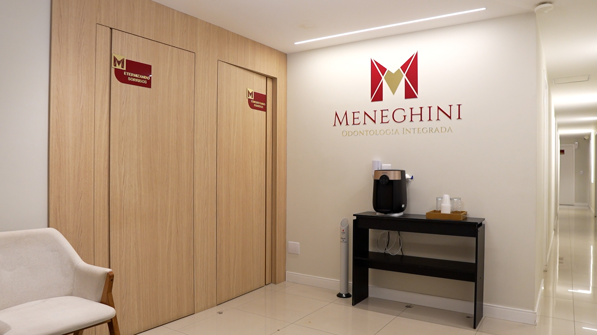
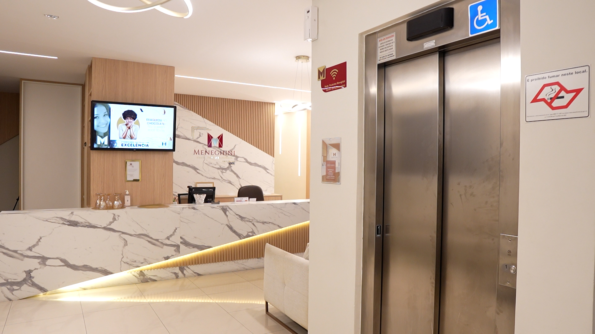
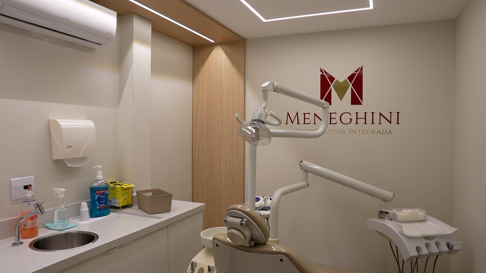
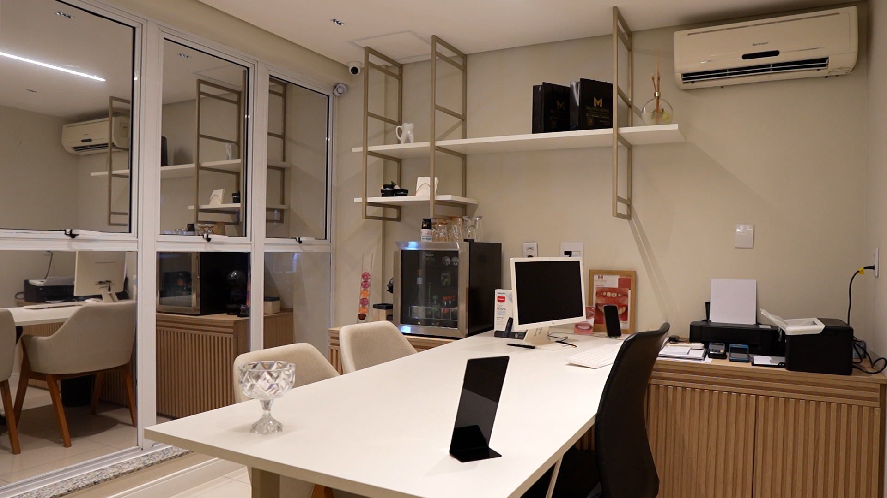
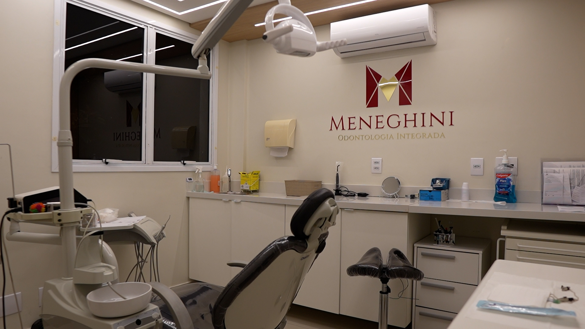
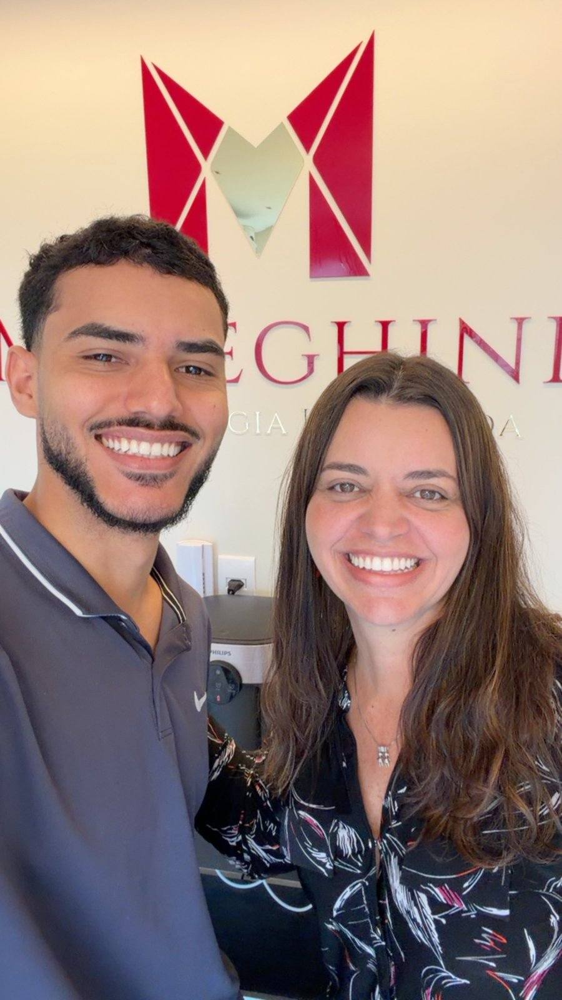

# Levantamento de campo: Meneghini Odontologia Integrada

Texto escrito pelo grupo a partir da entrevista com o proprietário e a gestora da clínica e da observação no local. Não é a transcrição das perguntas e respostas: é o que aprendemos sobre a clínica, organizado por assunto, na forma em que foi usado para escrever o README e montar o modelo.

## 1. Como o levantamento foi feito

A entrevista foi feita por Renan Silva dos Santos, em nome do grupo, com Fábio Meneghini, proprietário, e Helen Meneghini, gestora da clínica, na própria clínica, em 15 de setembro de 2026. O roteiro tinha três blocos: identificação e porte, processos do dia a dia e regras de cada etapa (orçamento, agendamento, laboratório e pagamento).

Depois da devolutiva do professor sobre a Entrega 1, fizemos uma segunda rodada de perguntas em 9 de novembro de 2026, sobre os pontos que tinham ficado de fora: cobrança e inadimplência, o que acontece depois do tratamento, cadastro de colaboradores, guarda do prontuário, esterilização e compras.

Renan trabalha na clínica, na equipe de marketing. Isso facilitou o acesso e a observação do dia a dia, mas o levantamento foi feito pela entrevista com o proprietário, como o trabalho pede. O que vem da observação está separado, na seção 6.

## 2. A clínica

A Meneghini Odontologia Integrada é uma clínica odontológica particular, com fins lucrativos, na Av. Leôncio de Magalhães, 162, Jardim São Paulo, São Paulo (SP). Atende somente particular, sem convênio. Tem uma única unidade.

Em números: 7 consultórios, com 7 cadeiras ativas; cerca de 30 colaboradores; 4 especialidades (implantodontia, clínica geral, ortodontia e endodontia), além da avaliação inicial; e um laboratório de prótese próprio, dentro da clínica.

Os colaboradores se dividem entre dentistas, auxiliares de saúde bucal (ASB), recepção, financeiro, relacionamento, campanha, marketing, comercial, laboratório, administrativo e apoio (manobrista). Há um diretor clínico, que é dentista: faz a consulta de alta ao fim de cada tratamento, atende avaliações novas e, às vezes, cirurgias. Há uma gestora que lidera os setores administrativo e financeiro.

Os consultórios não são fixos por dentista. A alocação é feita pela agenda e pela data, e pode mudar durante a semana. Por isso, no modelo, o consultório é definido em cada agendamento, e não no cadastro do dentista.

## 3. O caminho do paciente

O proprietário descreveu o fluxo nesta ordem: captação, avaliação, negociação, agendamento, execução (com o laboratório quando precisa de peça) e pagamento, que evolui junto com o tratamento.

**Captação.** O principal canal é o anúncio. Também chegam pacientes por indicação, pela fachada e por parcerias. Os leads (pessoas que ainda não vieram à clínica) ficam em uma planilha do time de agendamento; a maioria não vira paciente, e só esse time tem acesso. A pessoa entra no cadastro quando comparece à avaliação.

**Avaliação.** Não tem custo. O dentista avaliador examina o paciente e já define o preço do tratamento, montando o orçamento a partir da tabela de preços.

**Negociação.** O caso passa do avaliador para o comercial, que negocia as condições com o paciente. O preço é tabelado, mas o dentista e o comercial têm margem para dar desconto.

**Agendamento.** O comercial repassa à recepção, que marca as primeiras consultas. A prioridade é a parte clínica ou o que for mais urgente.

**Execução.** As sessões seguem o plano, e o tratamento avança conforme a evolução. Numa mesma consulta o dentista pode fazer mais de um procedimento.

**Laboratório.** Quando o tratamento precisa de uma peça (coroa, prótese), o dentista faz o pedido ao laboratório da própria clínica. O pedido é por paciente, e a comunicação é entre dentista, recepção e laboratório. O prazo de entrega é combinado nessa comunicação; hoje não há controle formal de status.

**Pagamento.** As formas são à vista, parcelado no cartão e parcelado no boleto; o boleto exige 20% de entrada. O tratamento é executado de acordo com a evolução do pagamento.

## 4. Regras levantadas, por assunto

**Orçamento e tratamento.** O orçamento lista procedimentos avulsos e totalmente especificados, como "canal no dente X", "implante no dente Y", "fase cirúrgica apenas" ou "cirúrgica mais protética". O paciente pode aprovar só parte do orçamento, e isso acontece com frequência. Todos os procedimentos nascem em aberto e são concluídos um a um no sistema, conforme o planejamento avança. O orçamento aprovado vira contrato. Na clínica, esse orçamento costuma ser um planejamento geral, com tudo o que o paciente precisa já lançado, inclusive a manutenção do retorno.

**Agendamento.** Um agendamento é sempre um paciente com um dentista, em um consultório, em uma data e hora. Os estados são agendado, confirmado, atendido, falta e reagendado. Falta e desmarcação são registradas no sistema; o horário fica vago ou é preenchido por outro paciente disponível (encaixe).

**Financeiro e cobrança.** O pagamento é lançado por orçamento, e o orçamento aprovado vira contrato. As parcelas são registradas e baixadas no sistema, uma por mês. Uma pessoa do financeiro cuida da cobrança dos pacientes, incluindo a inadimplência. Quando o paciente acumula duas parcelas sem pagar, ele não agenda e o tratamento é interrompido; quando volta a pagar, o tratamento segue de onde parou no planejamento. Renegociação, juros e multa não foram mencionados e ficaram fora do modelo.

**Alta e retorno.** Quando o tratamento termina, o paciente faz uma consulta de alta com o diretor clínico, para verificação. Em geral o retorno é de seis meses, para manutenção ou limpeza. A recepção agenda o retorno conforme o processo da clínica, tudo registrado no sistema. Ela procura deixar o valor da manutenção ou limpeza pago antes e, perto da data, liga ou manda mensagem para o paciente marcar. Hoje não há pesquisa de satisfação nem reativação de paciente antigo.

**Cadastros.** O cadastro de colaboradores é feito no Controle Odonto por uma pessoa do setor administrativo, responsável só por colaboradores (também cuida de holerites, pagamentos e folha de ponto, que ficaram fora do modelo). As especialidades, os consultórios e a tabela de preços são mantidos pela gestora. Um dentista pode ter mais de uma especialidade.

**Prontuário.** O prontuário do paciente é digital e fica no Controle Odonto.

**Esterilização.** A clínica tem uma sala própria de esterilização de materiais. As auxiliares de saúde bucal fazem a esterilização e também auxiliam o dentista em sala.

## 5. Sistema atual

A clínica usa o Controle Odonto, um software próprio para odontologia, que atende bem as necessidades específicas da área e guarda o prontuário. A limitação declarada pelo proprietário é a integração limitada com outras ferramentas. Além dele, o marketing usa um CRM para leads e campanhas, e o time de agendamento usa uma planilha de leads. Esse é o ponto de partida do problema P1 do README: a informação existe, mas fica espalhada entre o sistema, a planilha e a conversa entre os setores.

## 6. O que observamos no local

Separamos aqui o que vimos do que foi dito na entrevista.

Vimos a entrada com o nome da clínica, a recepção, os consultórios com cadeira odontológica e a sala comercial e administrativa, que aparecem nas fotos abaixo. Vimos o laboratório de prótese funcionando dentro da clínica e a sala de esterilização, onde as auxiliares de saúde bucal processam o instrumental entre os atendimentos. Na recepção, vimos o Controle Odonto em uso para a agenda e o cadastro, e o contato com o paciente sendo feito por telefone e mensagem. Pelo trabalho de Renan no marketing, vimos também que o CRM de marketing e o Controle Odonto não conversam entre si: o lead que vira paciente é cadastrado de novo na recepção.

Nos pontos cobertos pelo trabalho, não encontramos diferença entre o que foi dito na entrevista e o que vimos acontecer.

## 7. O que ficou fora e por quê

Compras de materiais, cadastro de fornecedores e controle de estoque ficaram fora do levantamento: o grupo não teve acesso a essa área da clínica. Folha de pagamento (holerite, pagamento de colaborador e ponto), campanhas de marketing e contabilidade ficaram fora por escolha de escopo, porque não fazem parte do caminho do paciente. Os leads ficaram fora porque existem só na planilha do time de agendamento e a maioria não vira paciente. Registramos essas limitações no README em vez de preencher com um processo genérico.

## 8. Fotos

Fotos do local, feitas pelo grupo:

  
  
  

  
  

*Da esquerda para a direita, de cima para baixo: entrada com o nome da clínica, recepção, consultório, sala comercial e administrativa e um segundo consultório.*

Registro do contato:

  

*Renan Silva dos Santos, integrante do grupo, com Helen Meneghini, gestora da clínica, na recepção (novembro de 2026).*
